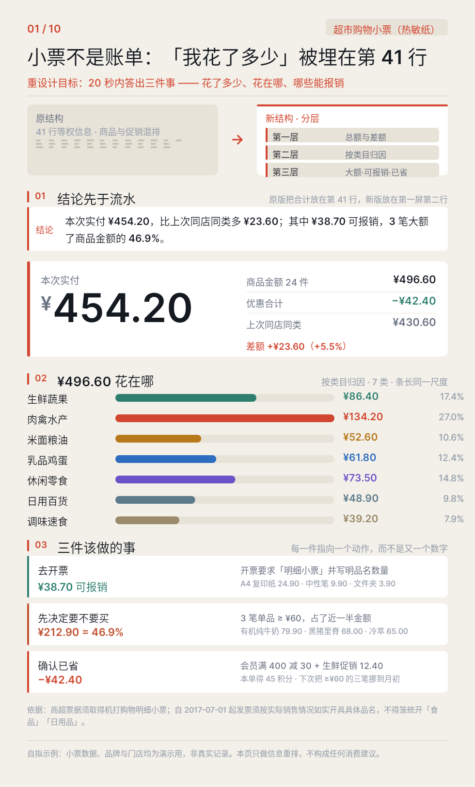
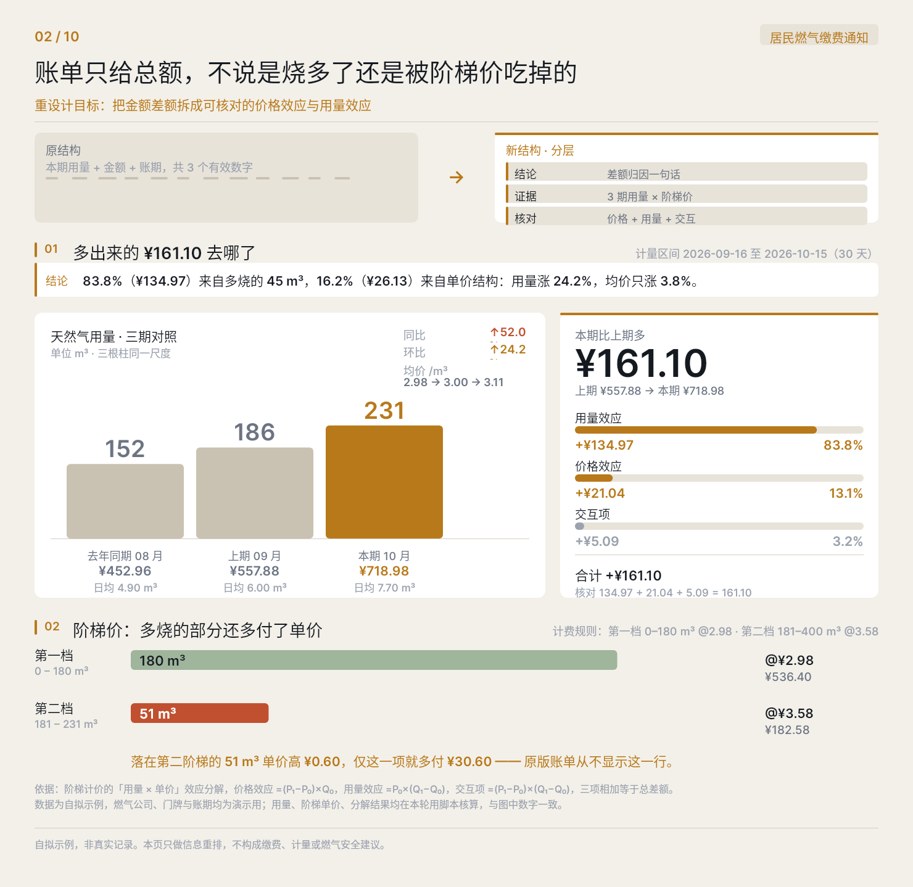
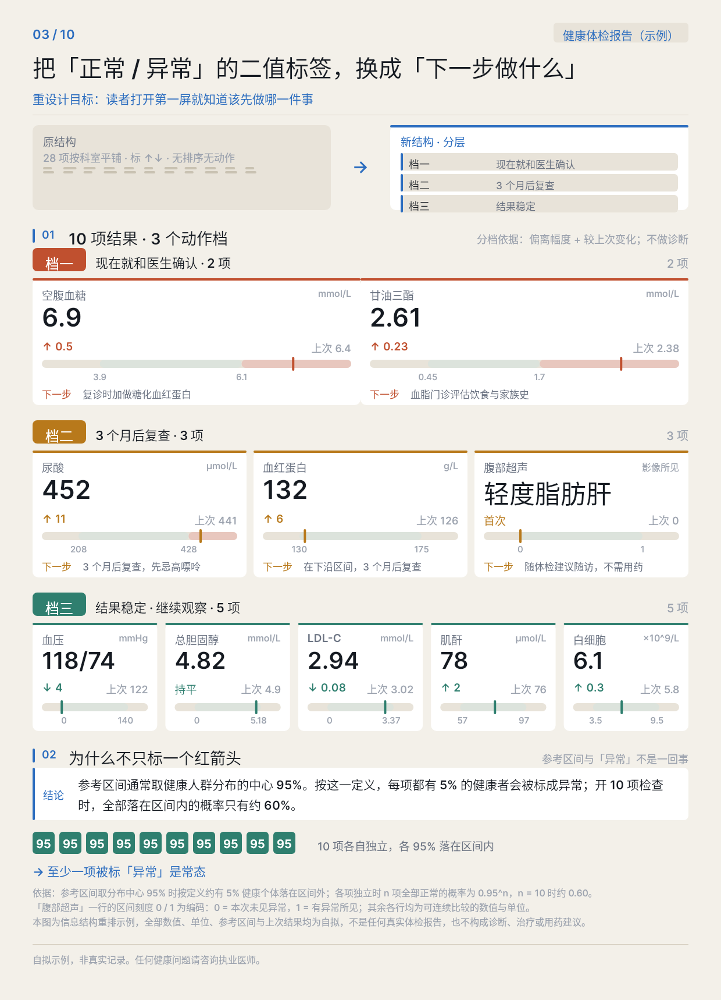
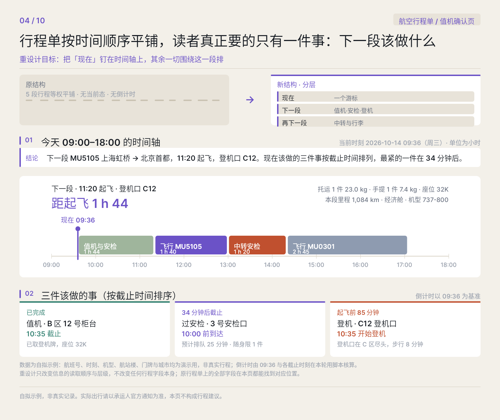
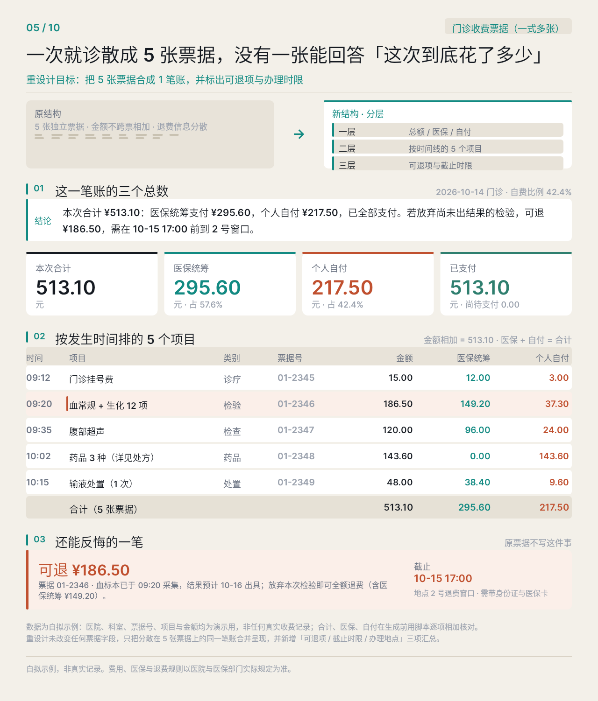
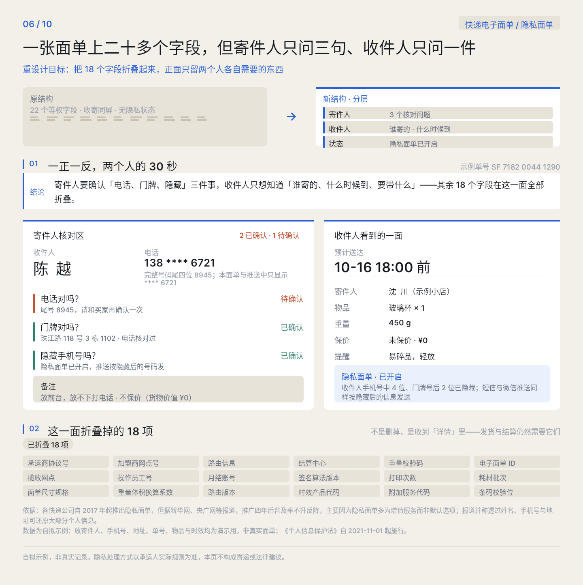
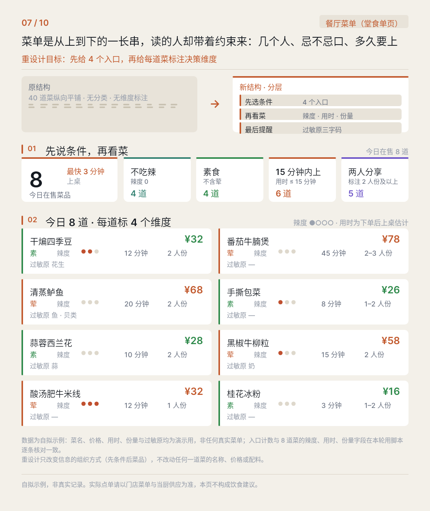
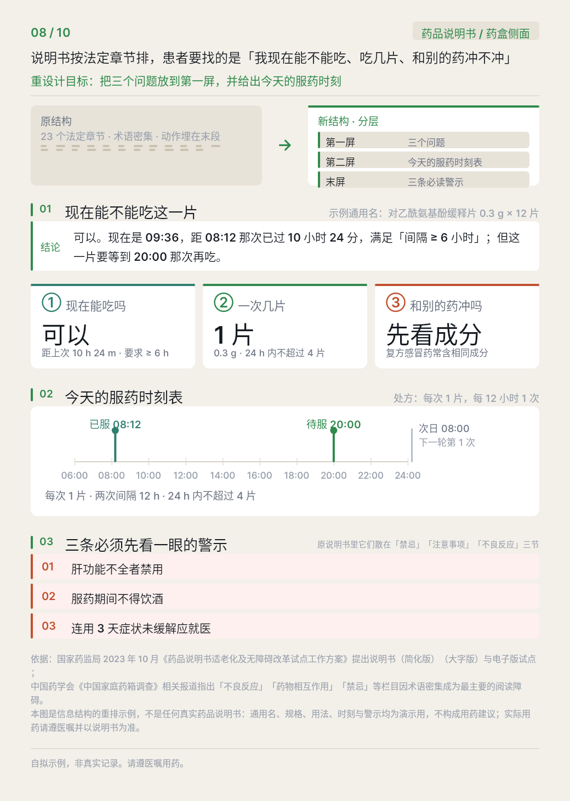
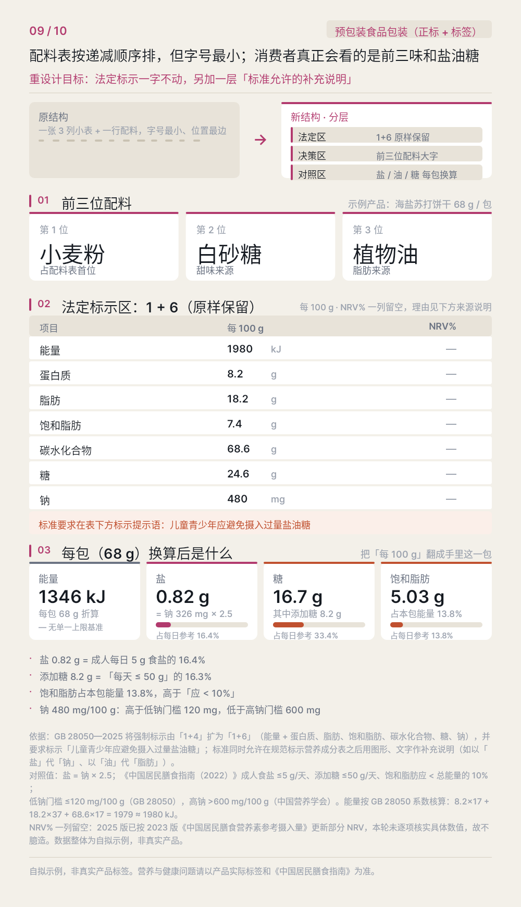
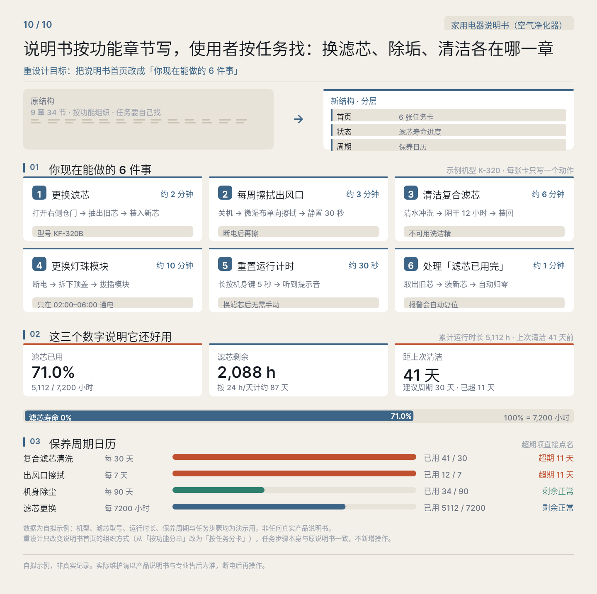

# B06 画廊 · 删掉无用信息之后

> 生成时间：2026-10-15T09:20:26+08:00

十件全部为自拟示例，非真实记录；原版结构为中性抽象示意；纯 DSL，无 <Image> 与外部素材。

## case-01 · 超市购物小票（热敏纸）

**核心问题**：我花了多少，花在哪，哪些能报销

**隔了什么**：41 行等权信息，合计压在第 41 行；品类与促销混排在同一列，没有任何分组

**新版第一层**：结论行 + 品类归因条 + 三个动作

- PNG：[`case-01/final.png`](case-01/final.png) · DSL：[`case-01/final.snapshot`](case-01/final.snapshot) · 笔记：[`case-01/case.md`](case-01/case.md)

## case-02 · 居民燃气缴费通知

**核心问题**：这期为什么涨了

**隔了什么**：只给用量、金额、账期三个有效数字，阶梯价的那一行在原账单上根本不显示

**新版第一层**：差额归因一句话 + 3 期用量对照 + 阶梯明细

- PNG：[`case-02/final.png`](case-02/final.png) · DSL：[`case-02/final.snapshot`](case-02/final.snapshot) · 笔记：[`case-02/case.md`](case-02/case.md)

## case-03 · 健康体检报告

**核心问题**：我现在该先做哪一件事

**隔了什么**：28 项按科室平铺，每项只有「标 ↑↓」，没有排序也没有动作

**新版第一层**：三档分层 + 每项一步动作 + 为什么不能只标红箭头

- PNG：[`case-03/final.png`](case-03/final.png) · DSL：[`case-03/final.snapshot`](case-03/final.snapshot) · 笔记：[`case-03/case.md`](case-03/case.md)

## case-04 · 航空行程单 / 值机确认页

**核心问题**：下一段该做什么

**隔了什么**：5 段行程等权平铺，没有当前时刻，没有倒计时

**新版第一层**：当前游标 + 距下一段倒计时 + 按截止时间排序的三件事

- PNG：[`case-04/final.png`](case-04/final.png) · DSL：[`case-04/final.snapshot`](case-04/final.snapshot) · 笔记：[`case-04/case.md`](case-04/case.md)

## case-05 · 门诊收费票据（一式多张）

**核心问题**：这次到底花了多少

**隔了什么**：5 张独立票据，金额不跨票相加，退费信息分散在各张的末尾

**新版第一层**：三个总数 + 按发生时间排的 5 项 + 可退项与截止时限

- PNG：[`case-05/final.png`](case-05/final.png) · DSL：[`case-05/final.snapshot`](case-05/final.snapshot) · 笔记：[`case-05/case.md`](case-05/case.md)

## case-06 · 快递电子面单 / 隐私面单

**核心问题**：寄件人只问三句，收件人只问一件

**隔了什么**：22 个等权字段，收寄同屏，无隐私状态

**新版第一层**：正反两面 + 隐私状态 + 已折叠的 18 项清单

- PNG：[`case-06/final.png`](case-06/final.png) · DSL：[`case-06/final.snapshot`](case-06/final.snapshot) · 笔记：[`case-06/case.md`](case-06/case.md)

## case-07 · 餐厅菜单（堂食单页）

**核心问题**：几个人、忌不忌口、多久要上

**隔了什么**：40 道菜纵向平铺，无分类、无维度标注

**新版第一层**：4 个决策入口（人数/辣度/素食/上菜时限）+ 每道菜 4 个维度

- PNG：[`case-07/final.png`](case-07/final.png) · DSL：[`case-07/final.snapshot`](case-07/final.snapshot) · 笔记：[`case-07/case.md`](case-07/case.md)

## case-08 · 药品说明书 / 药盒侧面

**核心问题**：我现在能不能吃这一片

**隔了什么**：23 个法定章节，术语密集，动作埋在末段

**新版第一层**：能不能吃 / 一次几片 / 和别的药冲不冲 + 24h 时刻表 + 3 条警示

- PNG：[`case-08/final.png`](case-08/final.png) · DSL：[`case-08/final.snapshot`](case-08/final.snapshot) · 笔记：[`case-08/case.md`](case-08/case.md)

## case-09 · 预包装食品包装（正标 + 标签）

**核心问题**：盐油糖到底占多少

**隔了什么**：一张 3 列小表 + 一行配料，字号最小、位置最边

**新版第一层**：前三位配料大字 + 法定 1+6 原样 + 每包换算

- PNG：[`case-09/final.png`](case-09/final.png) · DSL：[`case-09/final.snapshot`](case-09/final.snapshot) · 笔记：[`case-09/case.md`](case-09/case.md)

## case-10 · 家用电器说明书（空气净化器）

**核心问题**：换滤芯、尘垢、清洁各在哪一章

**隔了什么**：9 章 34 节按功能组织，任务要自己找

**新版第一层**：6 张任务卡 + 滤芯寿命进度 + 保养周期日历

- PNG：[`case-10/final.png`](case-10/final.png) · DSL：[`case-10/final.snapshot`](case-10/final.snapshot) · 笔记：[`case-10/case.md`](case-10/case.md)
