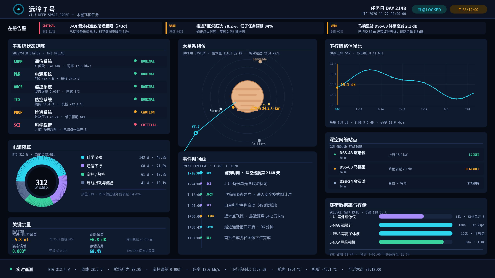
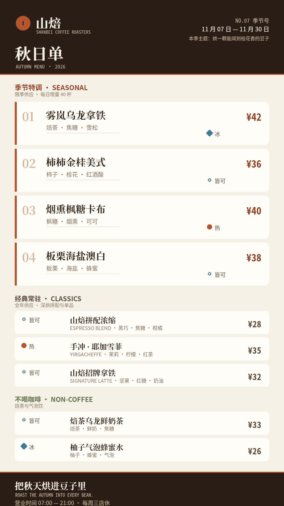
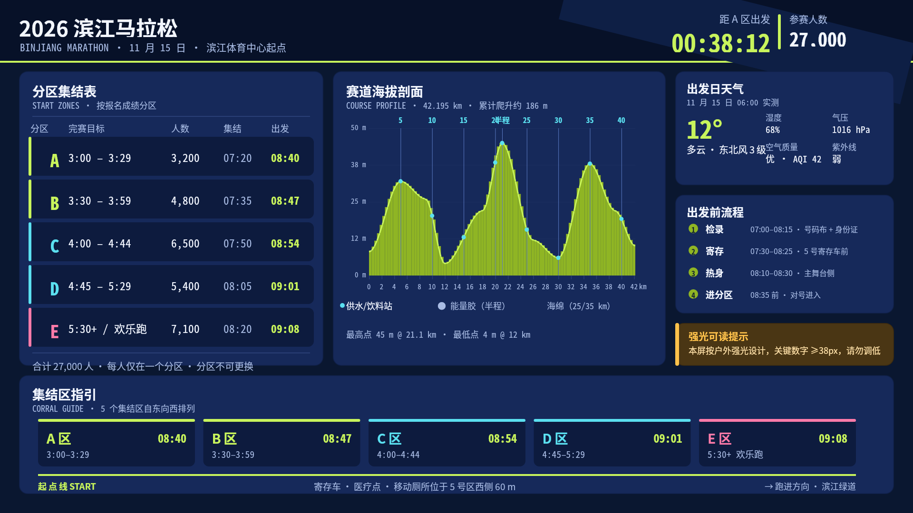
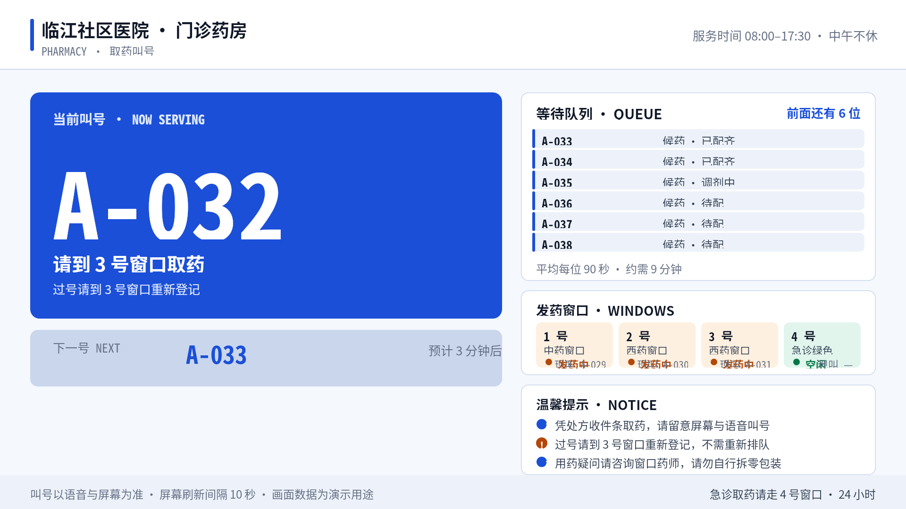
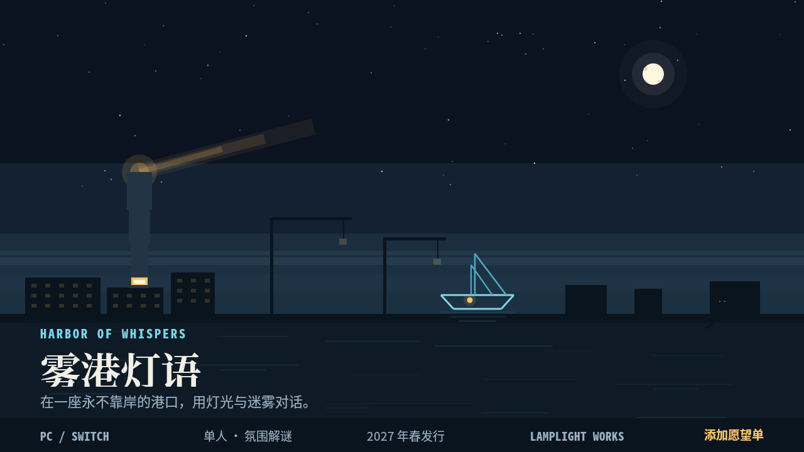
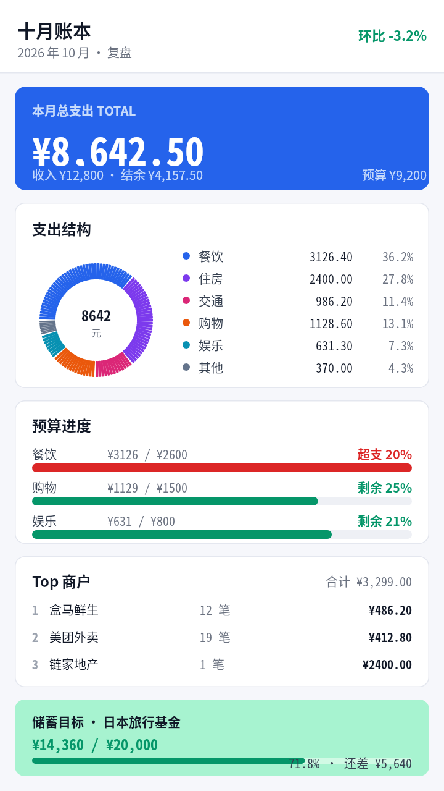
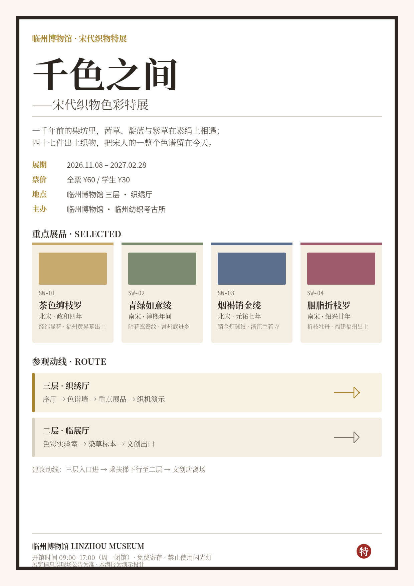
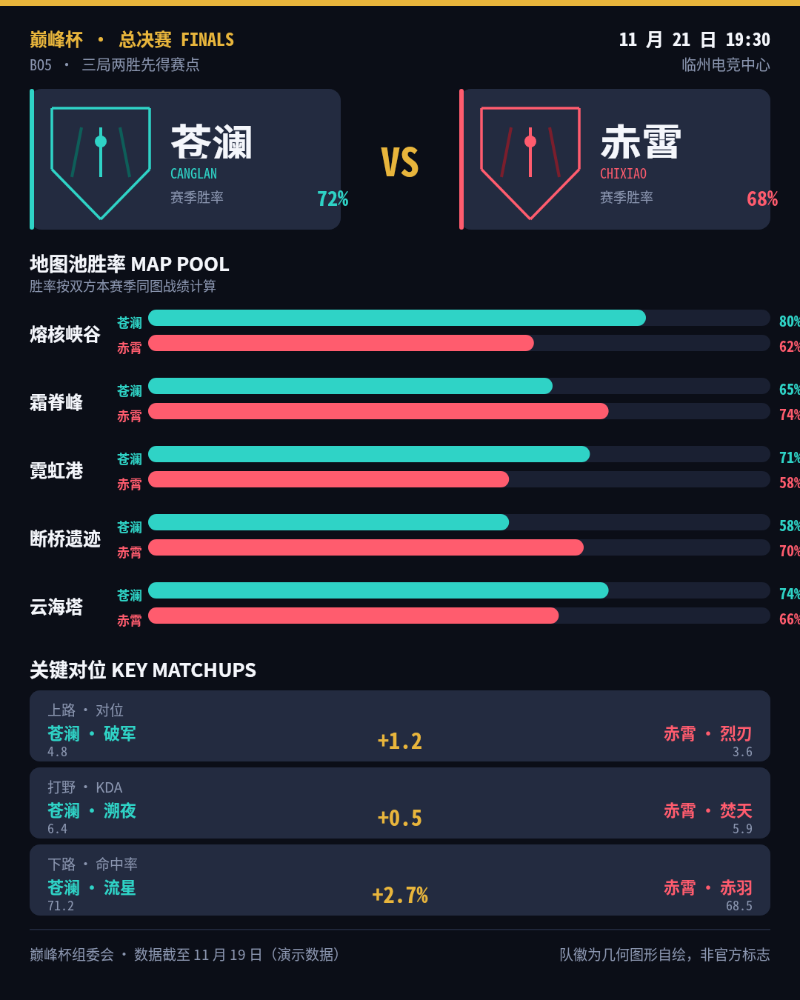
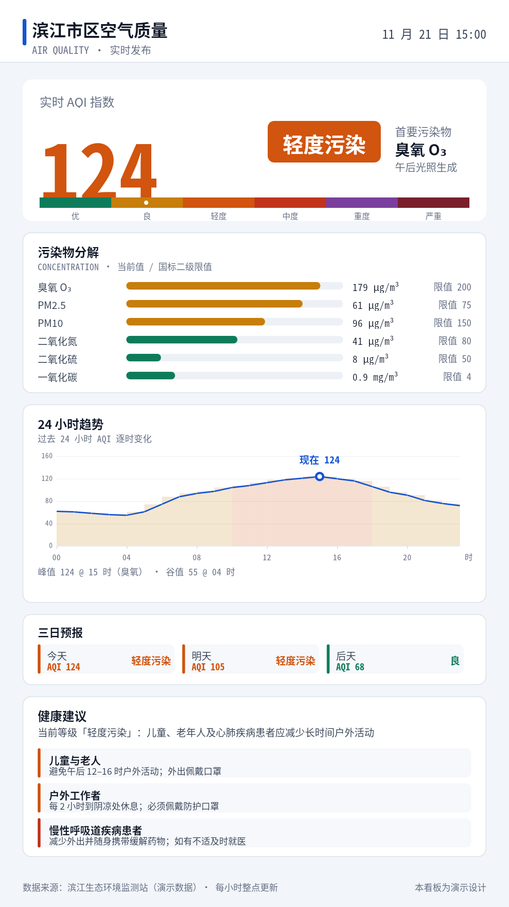
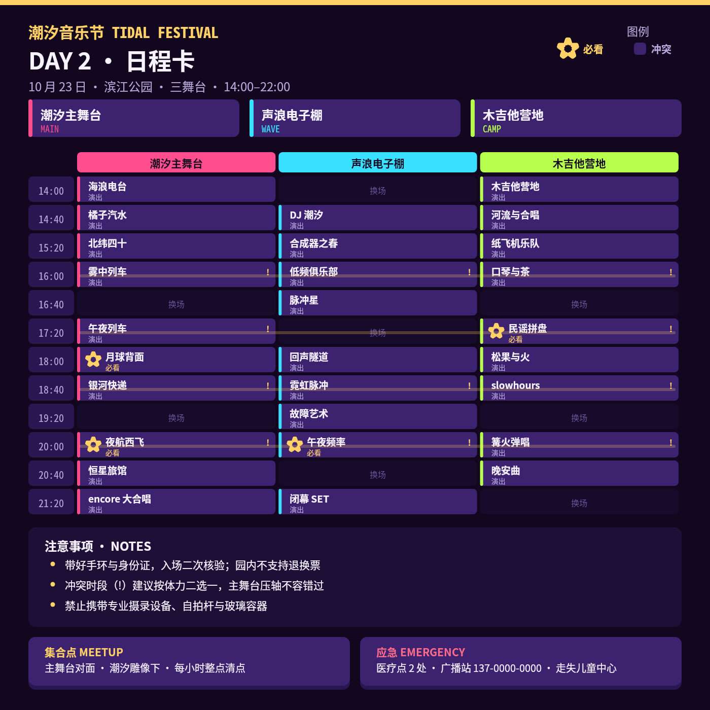

# B01 · 作品画廊

> 全部图片为 open-snapshot 服务真实渲染字节；点击查看大图。

## 01. 远瞳 7 号 · 深空遥测数据墙（2560×1440（横屏 4K 大屏））

- 受众/场景：任务控制中心飞控团队（值班工程师、飞控主管、科学运营） —— 控制中心 4K 值守大屏，24 小时运行，观看距离 3–8 米，暗环境
- 使用目标：一屏掌握探测器健康度、能源预算、下行链路强度、轨道相位与下一事件倒计时；异常必须最先被看到
- 视觉主张：深空黑底 + 青蓝/琥珀双色编码；异常条置于视线起点（左上头部下方）；等宽字体承载全部动态数字
- 详情与完成标准证据：[case-01/case.md](case-01/case.md)

## 02. 山焙 · 季节咖啡菜单板（1080×1920（竖屏店内常显））

- 受众/场景：咖啡馆内顾客与咖啡师 —— 竖屏菜单板 07:00–21:00 常显，观看距离 1–2 米，暖光店内
- 使用目标：30 秒内看清当季特调、风味、价格并完成点单决策
- 视觉主张：白底暖褐单色系；编号 01–04 建立季节组视觉序列；温度标记用形状双编码（实心圆=热、菱形=冰、圆环=皆可）
- 详情与完成标准证据：[case-02/case.md](case-02/case.md)

## 03. 滨江马拉松 · 起点集结大屏（1920×1080（横屏户外大屏））

- 受众/场景：已检录跑者与配速员 —— 起点拱门下方大屏，赛前 40 分钟，白天强光户外
- 使用目标：确认分区、出发时间、赛道海拔与补给点位置、当日天气
- 视觉主张：深蓝底 + 荧光绿主色；斜切动势带；分区色带（A/B 绿、C/D 青、E 粉）建立集结顺序
- 详情与完成标准证据：[case-03/case.md](case-03/case.md)

## 04. 临江社区医院 · 取药叫号屏（1920×1080（横屏药房窗口上方））

- 受众/场景：候药患者（含老年用户） —— 医院走廊 3–5 米观看，荧光灯环境，无障碍优先
- 使用目标：不错过叫号；知道等几位、大概多久
- 视觉主张：浅色 civic 底 + 蓝色主区；当前叫号 196px 超大数字；状态用圆点 + 文字双编码
- 详情与完成标准证据：[case-04/case.md](case-04/case.md)

## 05. 雾港灯语 · 独立游戏主视觉（1280×720（网页头图 16:9））

- 受众/场景：Steam 商店浏览者 —— 桌面浏览器暗色页面，一屏停留 3–5 秒
- 使用目标：被氛围击中，理解「雾中港口的灯光解谜」并点击愿望单
- 视觉主张：冷暖对比：灯塔暖光 vs 海面冷色；≥5 层剪影（仓库/起重机/灯塔/船/猫）由雾带分隔；星点用确定性伪随机生成
- 详情与完成标准证据：[case-05/case.md](case-05/case.md)

## 06. 十月账本 · 个人财务月度复盘（720×1280（手机竖屏））

- 受众/场景：28 岁城市白领 —— 晚上卧室床上单手刷手机，暗环境
- 使用目标：10 秒看懂本月总支出、哪类超支、结余与下月可支配
- 视觉主张：浅色干净金融风；蓝色总支出卡 + 六段占比环 + 双编码预算条
- 详情与完成标准证据：[case-06/case.md](case-06/case.md)

## 07. 千色之间 · 博物馆特展导览海报（1240×1754（A2 竖比））

- 受众/场景：到场观众（取阅/展厅入口张贴） —— 印刷质感，40cm 视距手持
- 使用目标：了解展览主题、展期、票价、4 件重点展品与参观动线
- 视觉主张：纸底 + 织物色谱四色；衬线字体承载展览名/展品名；印章式落款；双层动线箭头
- 详情与完成标准证据：[case-07/case.md](case-07/case.md)

## 08. 巅峰杯总决赛 · 战队对比卡（1080×1350（4:5 社交卡））

- 受众/场景：赛事观众 —— 微博/X 传播，手机信息流，缩略图也要认得出
- 使用目标：赛前 15 秒掌握两队实力对比与关键对位
- 视觉主张：双队色对冲（青 vs 红）+ 金色差值；成对同尺度对比条；差值符号居中
- 详情与完成标准证据：[case-08/case.md](case-08/case.md)

## 09. 滨江市区 · 空气质量看板（1080×1920（公交站亭竖屏））

- 受众/场景：市民与户外工作者 —— 公交站亭竖屏，白天自然光，观看距离 1–3 米
- 使用目标：看当前 AQI、主要污染物、24h 趋势与健康建议
- 视觉主张：浅色 civic 看板；AQI 168px 大数字 + 六级国标色条 + 当前刻度；分层填充 24h 曲线
- 详情与完成标准证据：[case-09/case.md](case-09/case.md)

## 10. 潮汐音乐节 · Day 2 舞台日程卡（1400×1400（社交方卡））

- 受众/场景：已购票乐迷 —— 手机相册/信息流，行前与现场随时查看
- 使用目标：规划一天：识别三舞台时间冲突、锁定必看、找到集合点
- 视觉主张：高能量撞色：三舞台主题色（粉/青/黄绿）+ 金色必看星标；网格 + 冲突连线
- 详情与完成标准证据：[case-10/case.md](case-10/case.md)
