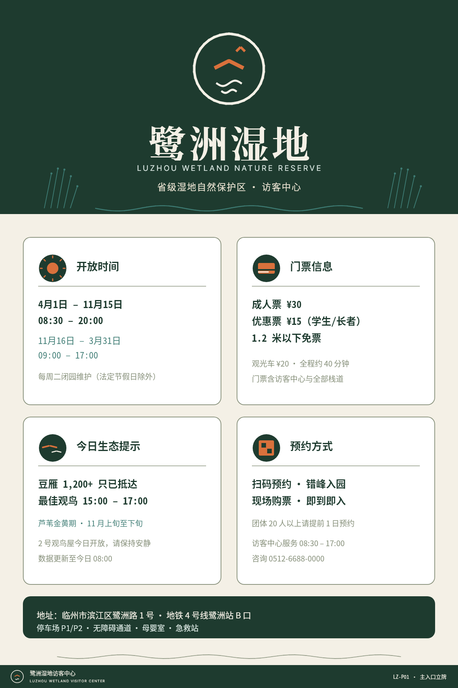
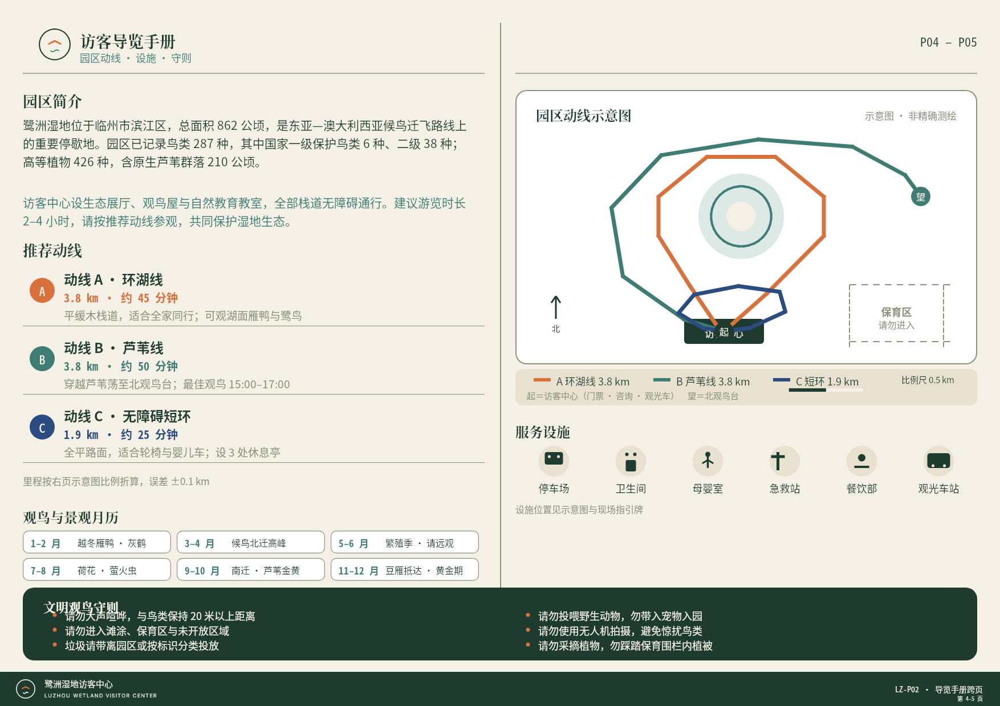
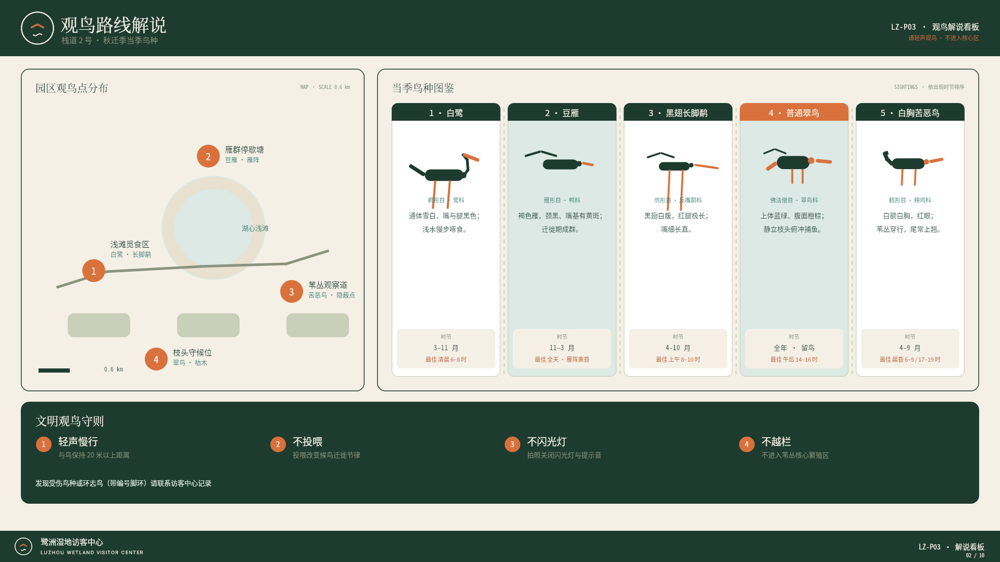
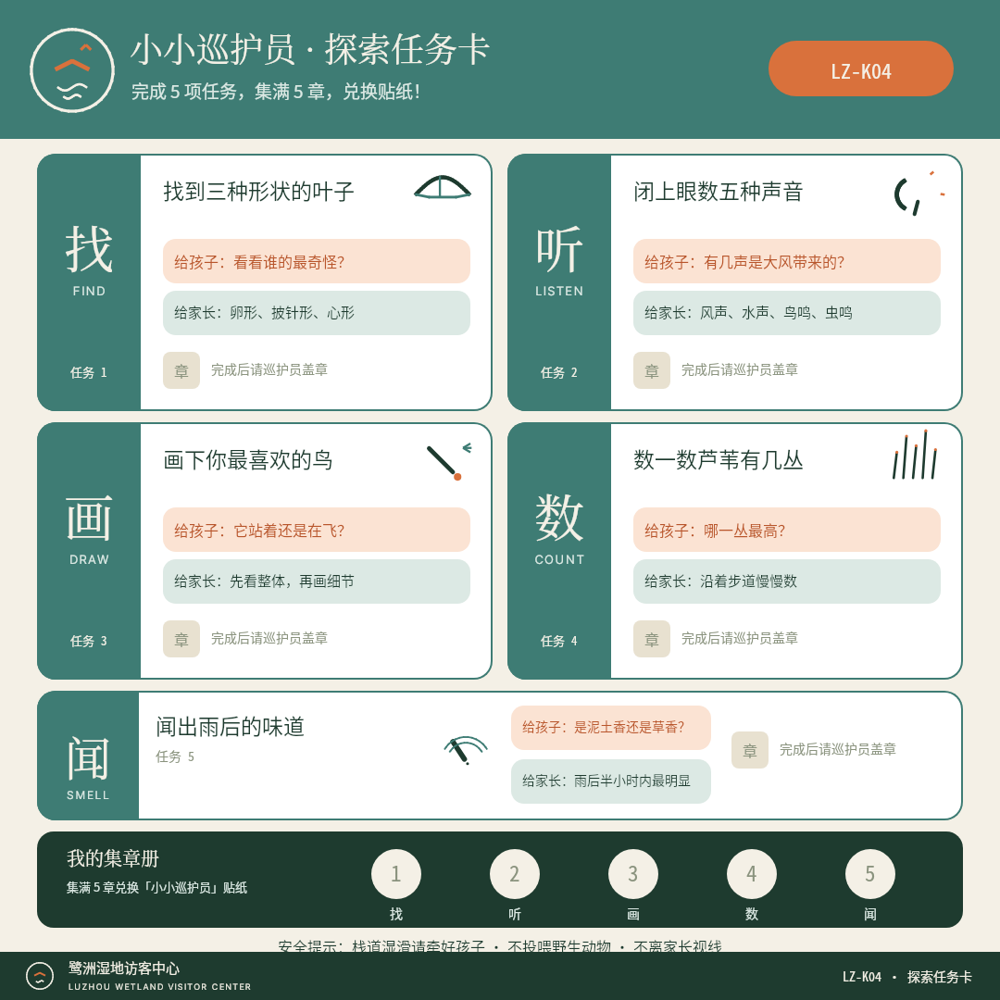
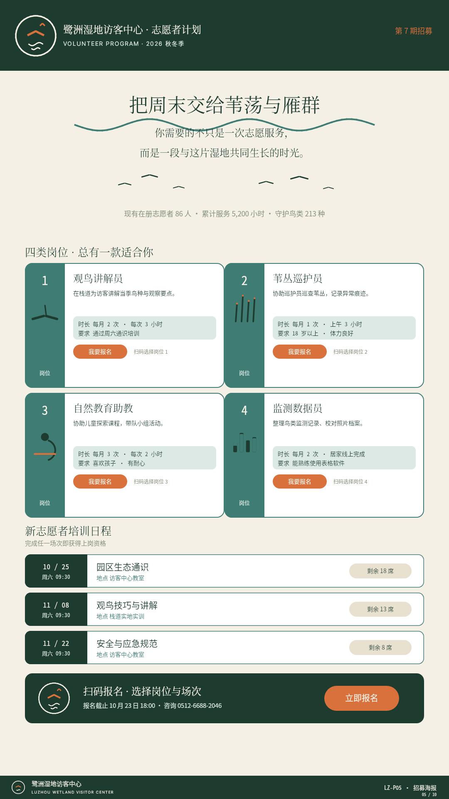
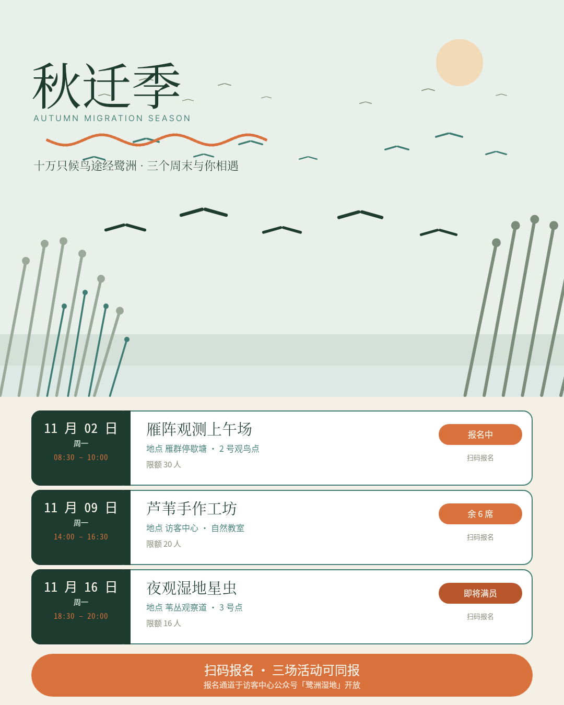
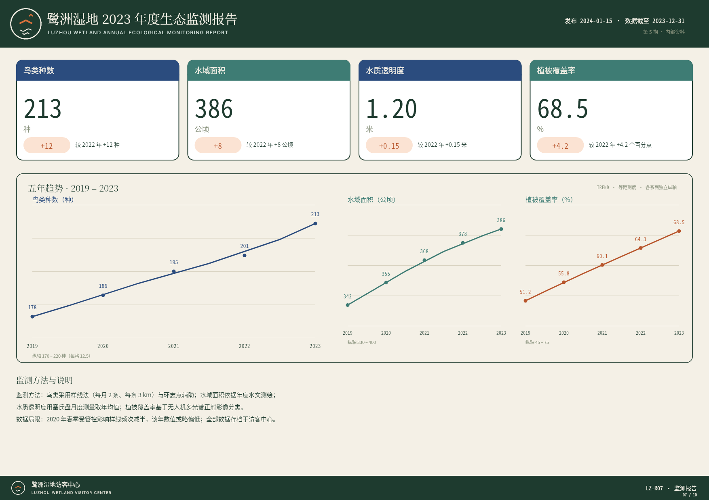
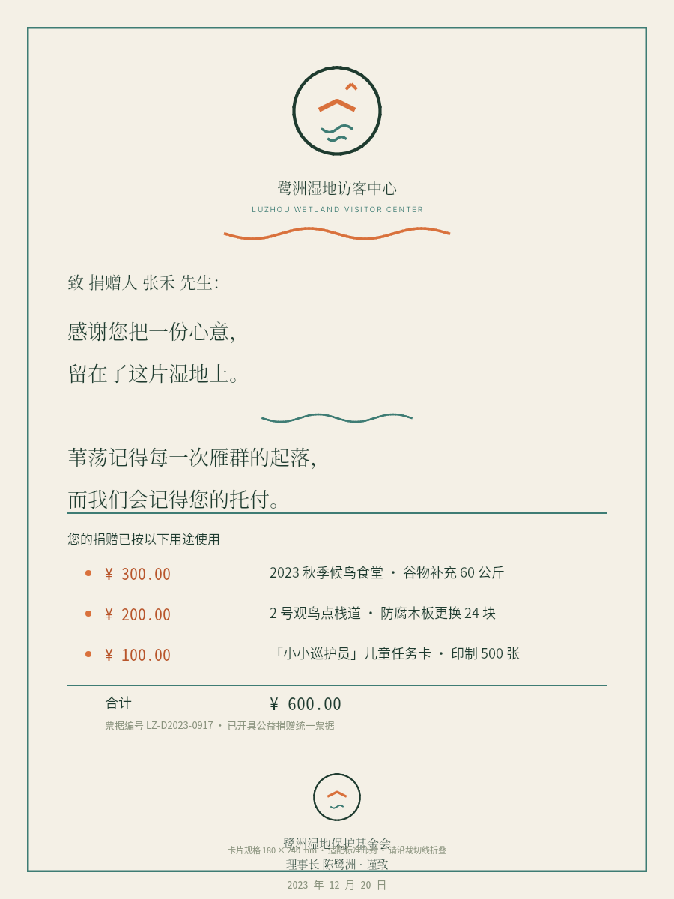
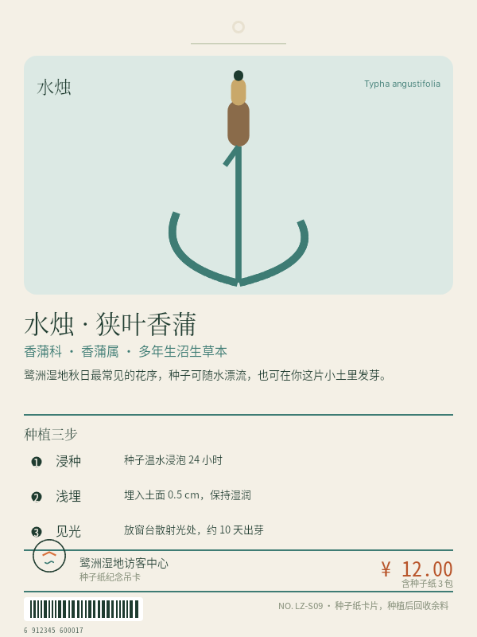
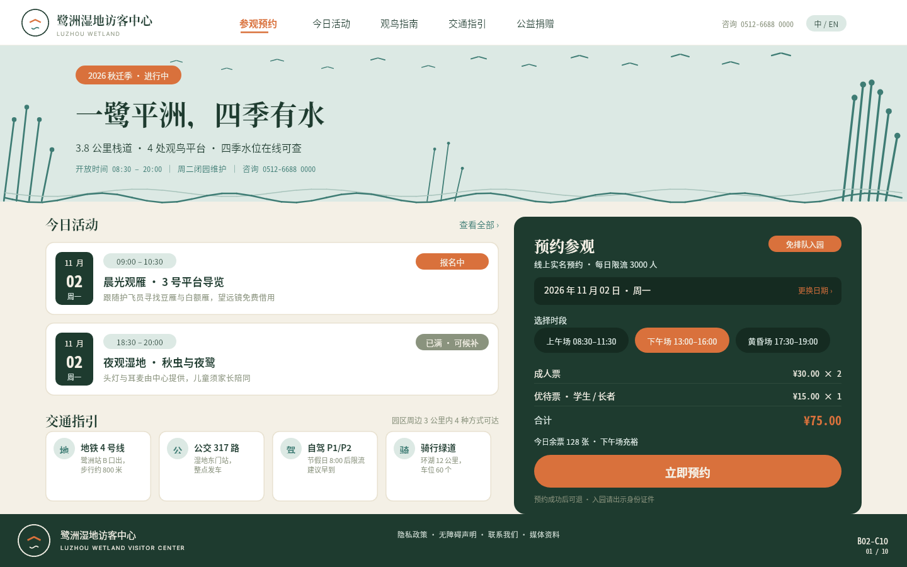

# B02 · 作品画廊

> 全部图片为 open-snapshot 服务真实渲染字节；点击查看大图。

> 横向缩略对比：`tmp/{RUN_ID}/B02/z-contact-sheet.png`

## 01. 园区主入口立牌（1200×1800（竖版立式标识））

- 受众/场景：自驾与步行抵达者（入园闸机旁立式标识，白天强光/夜间泛光）
- 使用目标：5 秒确认「到对了、开着、票价、今天能看什么」
- 视觉主张：深苇绿头部通栏（夜间背光清晰）+ 晨雾米主体；四类核心信息 2×2 白卡；双雁掠水徽记 + 水波/芦苇母题；等宽字体承载全部时刻票价
- 详情与完成标准证据：[case-01/case.md](case-01/case.md)

## 02. 访客导览手册内页跨页（1754×1240（横版手册跨页））

- 受众/场景：领取手册的访客（手持 40cm 阅读，边走边看）
- 使用目标：了解园区结构、三条推荐动线、服务设施与文明观鸟守则
- 视觉主张：左右页同网格基线；A/B/C 三动线以色区分（橙/青/靛）；比例尺 0.5 km 与折线几何长度严格对应
- 详情与完成标准证据：[case-02/case.md](case-02/case.md)

## 03. 观鸟路线解说看板（1920×1080（横版栈道旁看板））

- 受众/场景：栈道旁解说看板观众（1–2 米，日间）
- 使用目标：按季节找到观鸟点，认识 5 种当季鸟种与观察要点
- 视觉主张：左地图右图鉴双栏；5 鸟种自绘几何形态（鹭/雁/鹬/翠鸟/秧鸡五形可辨）；LZ 编号徽章串联地图与图鉴
- 详情与完成标准证据：[case-03/case.md](case-03/case.md)

## 04. 儿童自然探索任务卡（1080×1080（方卡，园区内塑封携带））

- 受众/场景：6–10 岁亲子家庭（任务卡塑封，园区内携带）
- 使用目标：完成 5 项探索任务并集章，兑换「小小巡护员」贴纸
- 视觉主张：2×2 任务格 + 第 5 张横卡；大图标 + ≤14 字短句；集章区 5 格圆形徽记；亲子双语气泡分区
- 详情与完成标准证据：[case-04/case.md](case-04/case.md)

## 05. 志愿者招募海报（1080×1920（竖版招募海报））

- 受众/场景：18–60 岁市民（社区公告栏/公众号推演）
- 使用目标：了解岗位差异，扫码报名周六培训
- 视觉主张：衬线大字主张 + 4 岗位行卡 + 培训日程条 + 报名 CTA；竖屏留白节奏稳定
- 详情与完成标准证据：[case-05/case.md](case-05/case.md)

## 06. 秋季迁徙季活动海报（1080×1350（4:5 社交竖版））

- 受众/场景：朋友圈/公众号传播，已关注用户转发
- 使用目标：3 秒被季节氛围击中，看清 3 场活动并报名
- 视觉主张：晨雾天色 + 三层雁阵（远小→近大）+ 芦苇剪影；3 张活动卡日期块/名称/时间/地点/名额/状态六级信息
- 详情与完成标准证据：[case-06/case.md](case-06/case.md)

## 07. 年度生态监测报告数据页（1754×1240（横版报告数据页））

- 受众/场景：捐赠人与管理者（官网/公众号年报，桌面细读）
- 使用目标：30 秒掌握本年度 4 项核心指标变化
- 视觉主张：4 指标卡（等宽大字 64px + 同比胶囊）+ 三系列 5 年趋势图（等距刻度）+ 方法说明；靛蓝/青双系列编码
- 详情与完成标准证据：[case-07/case.md](case-07/case.md)

## 08. 捐赠感谢卡（900×1200（竖卡，邮封适配））

- 受众/场景：收到感谢信的捐赠人（拆信场景，仪式感）
- 使用目标：感到被郑重对待，理解款项具体用途
- 视觉主张：衬线宽行距感谢语（行距 1.6+）+ 用途三行金额右对齐等宽 + 徽记与手写感签名；无促销元素
- 详情与完成标准证据：[case-08/case.md](case-08/case.md)

## 09. 湿地植物纪念标签（600×800（竖挂卡，纪念品店货架 30cm 观看））

- 受众/场景：纪念品店「种子纸」商品购买者（货架 30cm 观看）
- 使用目标：了解这是什么植物、怎么种、为何选它
- 视觉主张：SKY 图形面板 + 水烛自绘三结构（雌雄花序/茎/双叶弧）+ 种植三步 + 品牌价格 + 条码 + 吊卡孔
- 详情与完成标准证据：[case-09/case.md](case-09/case.md)

## 10. 访客中心数字首页（1440×900（桌面网页 16:10））

- 受众/场景：计划来访者（手机/桌面浏览器，行前）
- 使用目标：预约门票、找到今日活动与交通方式
- 视觉主张：白底导航条 + SKY 主视觉（雁阵/芦苇/双水波）+ INK 预约卡（首要行动召唤，视觉权重最高）+ 白卡内容区 + 品牌页脚带
- 详情与完成标准证据：[case-10/case.md](case-10/case.md)
