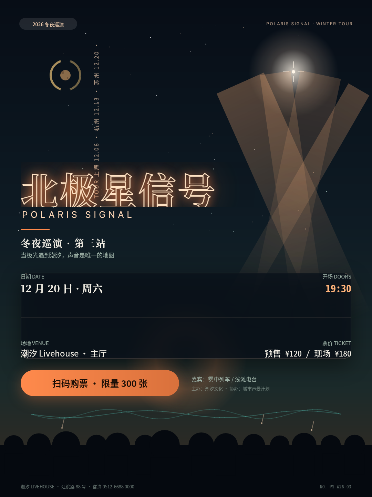
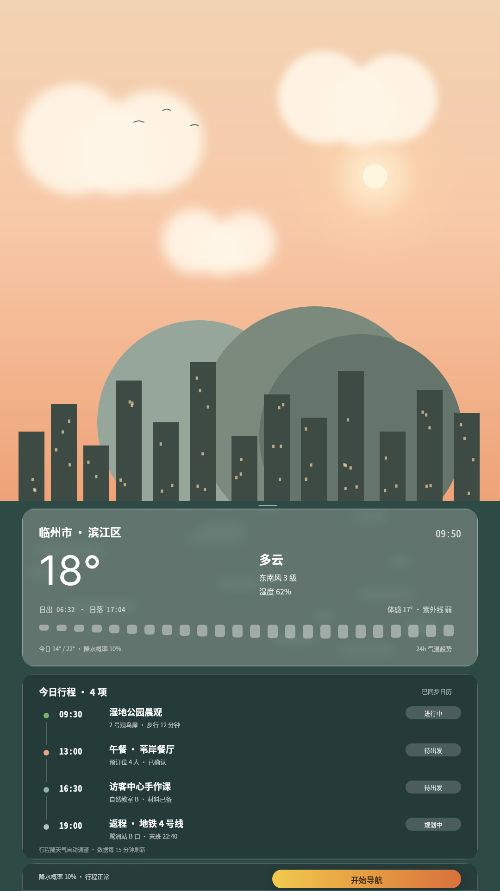
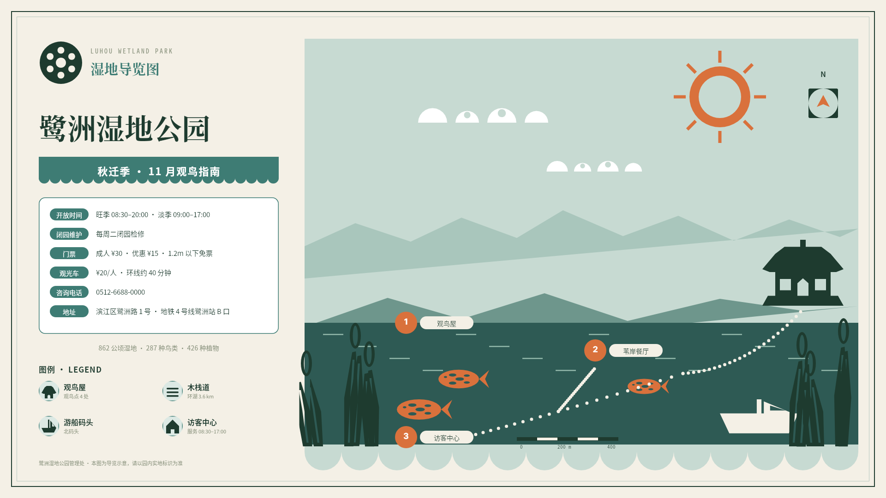
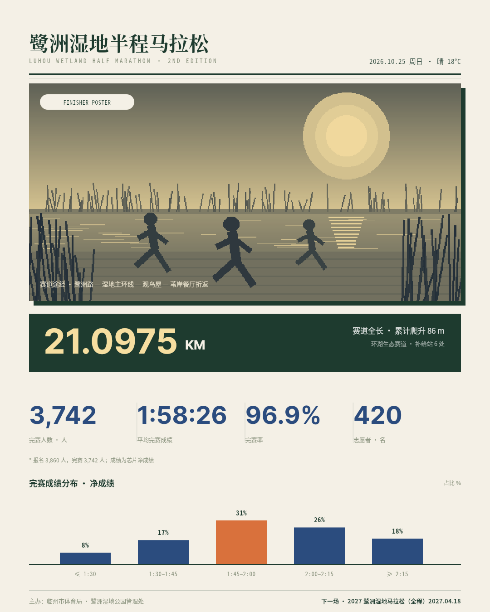
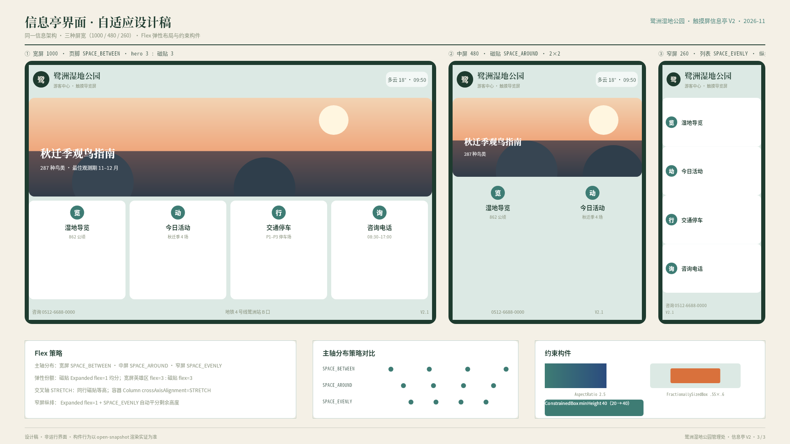
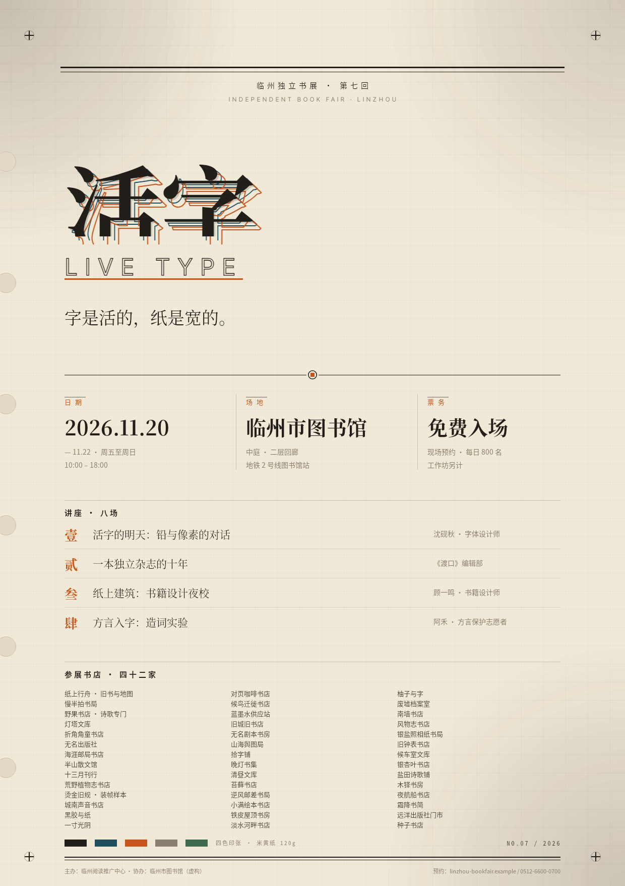
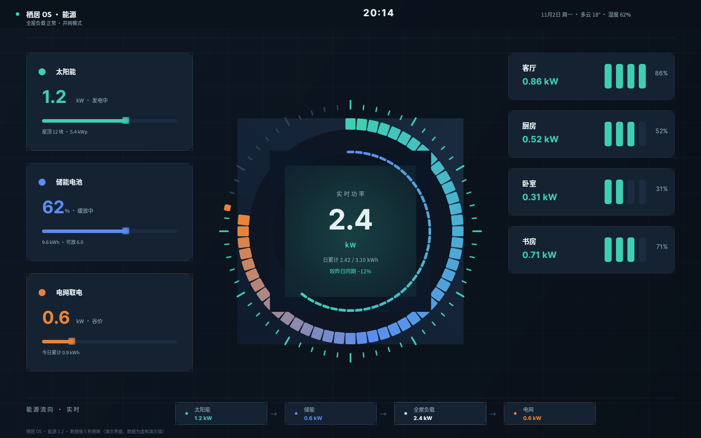
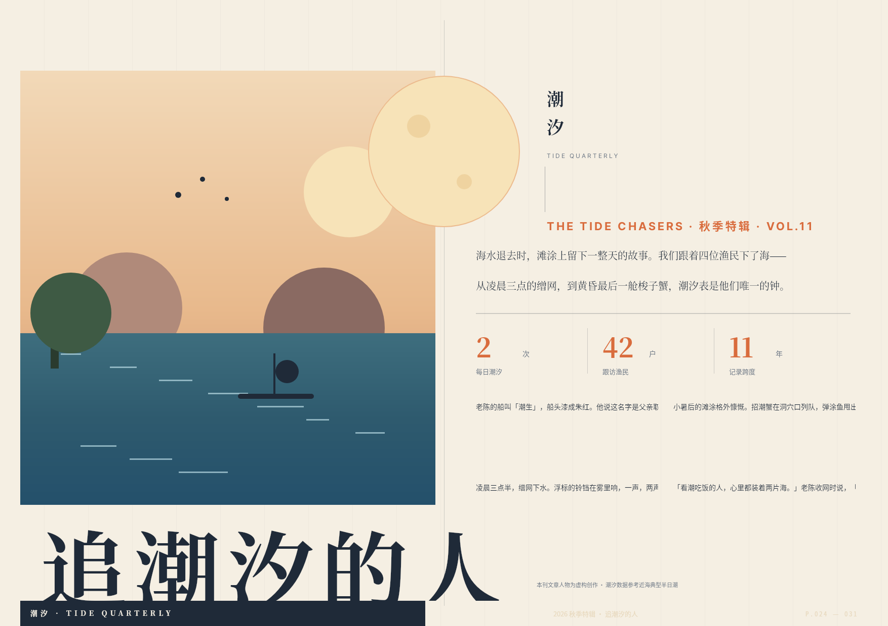

# B03 · 作品画廊

> 全部图片为 open-snapshot 服务真实渲染字节；点击查看大图。

> 横向缩略对比：`tmp/run-20261013-174209/B03/z-contact-sheet.png`

## 01. 霓虹演出海报（1080×1440（3:4 社交竖版））

- 受众/场景：独立音乐与夜场文化受众 · 社交平台传播的 livehouse 夜场演出海报
- 使用目标：3 秒内传递乐队名、巡演站次、日期场地与购票入口
- 主导手法：三层渐变夜空 + RADIAL 星晕 + Container transform 矩阵旋转光束 + 多层 textShadow 霓虹辉光 + Text STROKE 空心管描边 + 剪影收底
- 详情与完成标准证据：[case-01/case.md](case-01/case.md)

## 02. 毛玻璃天气行程卡（1080×1920（9:16 手机））

- 受众/场景：计划前往鹭洲湿地公园的访客 · 出行 App「今日行程」底部三层面板浮层
- 使用目标：一屏读完天气、当日行程与行动入口，面板浮动于实景之上
- 主导手法：frosted() 三层面板（ClipRRect + BackdropFilter 高斯毛玻璃）+ ImageFiltered 柔化云层 + 渐变天色 + 渐变 CTA + Flex 时间轴
- 详情与完成标准证据：[case-02/case.md](case-02/case.md)

## 03. 剪纸风国家公园导览图（1920×1080（16:9 横版壁画））

- 受众/场景：游客中心内全体访客（含亲子与长者） · 游客中心大幅墙面导览图
- 使用目标：远距离识别园区格局，近距离读取动线、观测点与规范信息
- 主导手法：ClipPath EVEN_ODD 多轮廓镂空剪纸（团花/云朵卷曲/鱼鳞/亭窗/芦苇中缝/烛穗环/船帆月牙）+ 分层剪影 + ClipOval 日月 + 云纹滚边
- 详情与完成标准证据：[case-03/case.md](case-03/case.md)

## 04. 双色马拉松数据海报（1080×1350（4:5 社交竖版））

- 受众/场景：完赛选手与跑步社群 · 赛事官方社交账号完赛数据海报
- 使用目标：一张图传递赛事规模与个人完赛数据，适合转发
- 主导手法：ColorFiltered 嵌套双色调（内层 SCREEN 靛蓝映射暗部 × 外层 MULTIPLY 暖黄映射亮部，作用于 PIL 生成灰度赛照 dataUri）+ Flex 大数字 + 偏移框破版
- 详情与完成标准证据：[case-04/case.md](case-04/case.md)

## 05. 自适应信息亭界面设计稿（1920×1080（16:10 设计稿纸））

- 受众/场景：园区触摸屏信息亭的界面设计评审者 · 同一信息架构在三种屏宽下的呈现（设计提案稿）
- 使用目标：证明一套 Flex 结构在 1000/480/260 三档宽度均成立
- 主导手法：Flex 弹性布局（Row/Column/Expanded/Flexible/Spacer + SPACE_BETWEEN/AROUND/EVENLY + crossAxisAlignment=STRETCH）+ AspectRatio / FractionallySizedBox / ConstrainedBox 约束构件
- 详情与完成标准证据：[case-05/case.md](case-05/case.md)

## 06. 活版印刷书展海报「活字」（1240×1754（A2 竖版））

- 受众/场景：独立书店与阅读爱好者 · 独立书展现场张贴的复古印刷海报
- 使用目标：传递书展届次、主题、日期场地与讲座名单
- 主导手法：Text STROKE 套印错版（青 +8 / 橙 +16 偏移）+ textShadow 压印 + decoration 装饰线 + letterSpacing 字距 + height 行距 + 衬线排版；纸纹/齿孔/十字标/晕墨全部用 DSL 图元构造
- 详情与完成标准证据：[case-06/case.md](case-06/case.md)

## 07. 智能家居能量环中控屏（1600×1000（16:10 横屏墙装屏））

- 受众/场景：家庭能源管理者（墙装中控屏旁观者） · 客厅墙面常驻能源中控界面
- 使用目标：远距离一眼读取总功率与能源结构，近距离看房间分布
- 主导手法：SWEEP 环形能量进度 + RADIAL 光晕 + 60 根矩阵旋转刻度 + ClipOval 环带嵌套
- 详情与完成标准证据：[case-07/case.md](case-07/case.md)

## 08. 儿童 App 启动页景深插画（1080×1920（9:16））

- 受众/场景：3–8 岁儿童及其家长 · 自然认知 App 冷启动页
- 使用目标：2 秒内建立自然认知品牌印象并等待加载
- 主导手法：ImageFiltered 分层景深（sigma 14/8/3/0 四层）+ Opacity 层间雾带 + Stack 层次 + ClipPath 叶形徽标
- 详情与完成标准证据：[case-08/case.md](case-08/case.md)

## 09. 杂志跨页破版特辑（1754×1240（√2 横版跨页））

- 受众/场景：生活方式杂志读者 · 秋迁观鸟特辑跨页编辑设计
- 使用目标：以破版构图传达「人潮与候鸟同潮」的特辑主题
- 主导手法：ClipRect 硬边裁切出血 + SizedOverflowBox 破界 + Positioned 跨栏压图
- 详情与完成标准证据：[case-09/case.md](case-09/case.md)

## 10. 产品发布电子邀请函（1080×1080（1:1 方卡））

- 受众/场景：受邀嘉宾（邮件/社交分发） · 「秋迁观鸟季」启幕仪式电子邀请函
- 使用目标：一卡传递活动名、日期时间地点与 RSVP 入口
- 主导手法：WidgetSpan 行内嵌件（日期徽章/序号徽章/菱形分隔）+ 嵌套 Span 混排（SERIF/INTER 数字/金色强调）+ Noto Color Emoji + decoration 层级
- 详情与完成标准证据：[case-10/case.md](case-10/case.md)
