# B04 · 作品画廊

> 全部图片为 open-snapshot 服务真实渲染字节；点击查看大图。

> 横向缩略对比：`tmp/run-20261013-174209/B04/z-contact-sheet.png`

## 01. 特辑总览：三层十属垂直剖面（1920×1080（16:9））

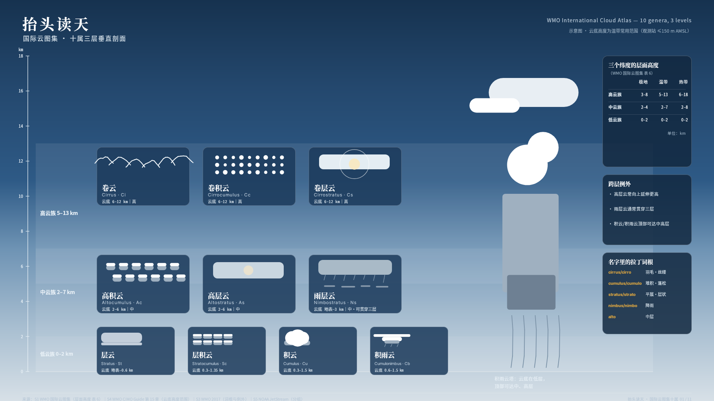

- 受众/场景：想「看懂天上那片云」的普通人；给孩子讲天的家长 · 特辑开篇总览——郊游/通勤时抬头对照的第一张图
- 使用目标：把 WMO 十属分类系统转化为一次从地面爬到对流层顶的垂直阅读
- 主导手法：分层天空渐变 + 高度轴 + 十枚云属芯片（各族插画）
- 主张溯源：`sources.json` claims 数组（case_id = case-01）
- 详情与完成标准证据：[case-01/case.md](case-01/case.md)

## 02. 观测三步法：一指量天（1080×1440（3:4））

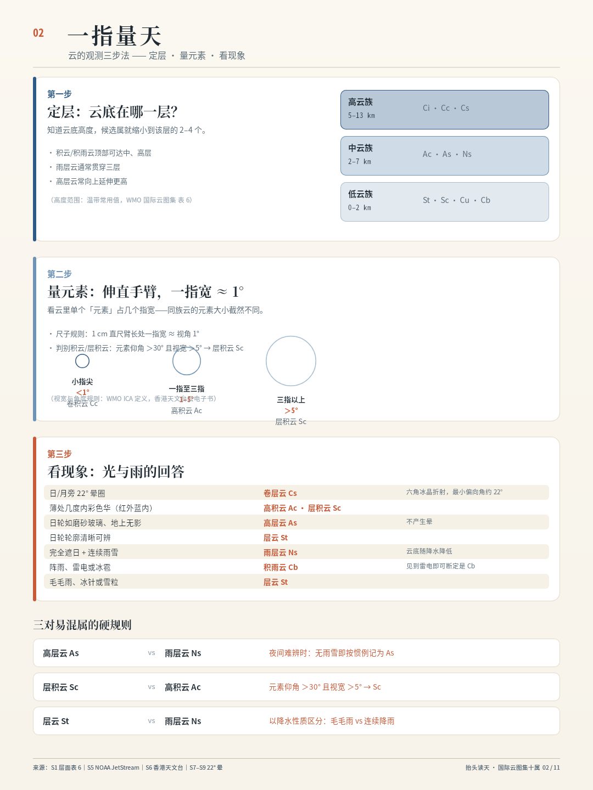

- 受众/场景：初学者——第一次想认真认云的人 · 方法图：抬手一指判定云属的三步流程
- 使用目标：把「一指量天」（视宽判属）变成可执行的三步动作
- 主导手法：浅色判定流图 + 手指比例图示 + 分支卡片
- 主张溯源：`sources.json` claims 数组（case_id = case-02）
- 详情与完成标准证据：[case-02/case.md](case-02/case.md)

## 03. 卷云 Cirrus (Ci) 图鉴页（1080×1350（4:5））

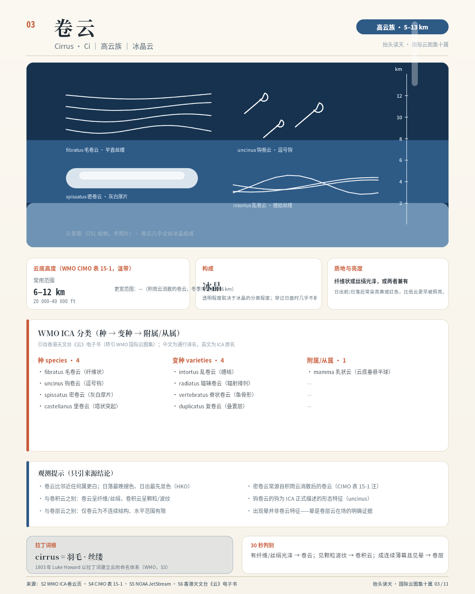

- 受众/场景：图鉴读者——抬头见到丝缕状云想确认属名的人 · 图鉴页 1/10：高云族首属
- 使用目标：辨认卷云四质地（fibratus/uncinus/spissatus/intortus）并读其天气含义
- 主导手法：天空剖面 + 质地变体曲线 + 高度轴范围带
- 主张溯源：`sources.json` claims 数组（case_id = case-03）
- 详情与完成标准证据：[case-03/case.md](case-03/case.md)

## 04. 卷积云 Cirrocumulus (Cc) 图鉴页（1080×1350（4:5））

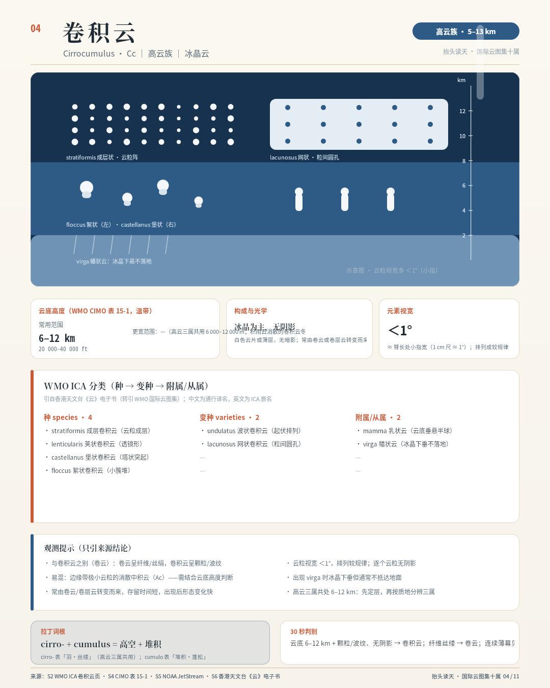

- 受众/场景：图鉴读者——见到颗粒/波纹状薄云想确认的人 · 图鉴页 2/10：高云族次属
- 使用目标：辨认卷积云的鱼鳞天排列，理解「视宽 ＜1°」这一硬判据
- 主导手法：嵌合颗粒阵列 + 1° 视宽标尺 + 高度轴范围带
- 主张溯源：`sources.json` claims 数组（case_id = case-04）
- 详情与完成标准证据：[case-04/case.md](case-04/case.md)

## 05. 卷层云 Cirrostratus (Cs) 图鉴页（含 22° 晕几何）（1080×1350（4:5））

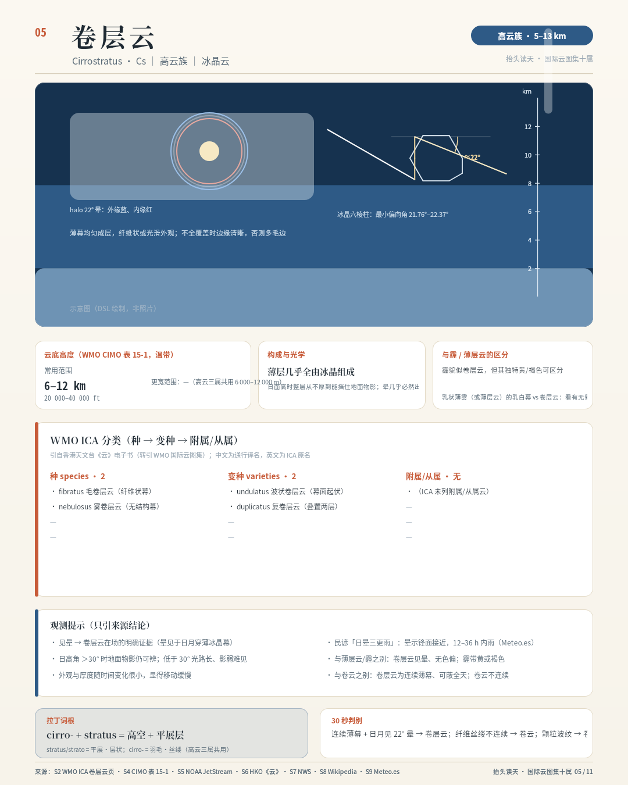

- 受众/场景：图鉴读者——见过日晕想知道那片云是什么的人 · 图鉴页 3/10：高云族末属 + 光学现象专页
- 使用目标：用 22° 晕反推卷层云在场，并解释晕的几何成因
- 主导手法：晕圈几何图解（太阳 + 22° 环 + 入射/折射路径）+ 高度轴范围带
- 主张溯源：`sources.json` claims 数组（case_id = case-05）
- 详情与完成标准证据：[case-05/case.md](case-05/case.md)

## 06. 高积云 Altocumulus (Ac) 图鉴页（1080×1350（4:5））

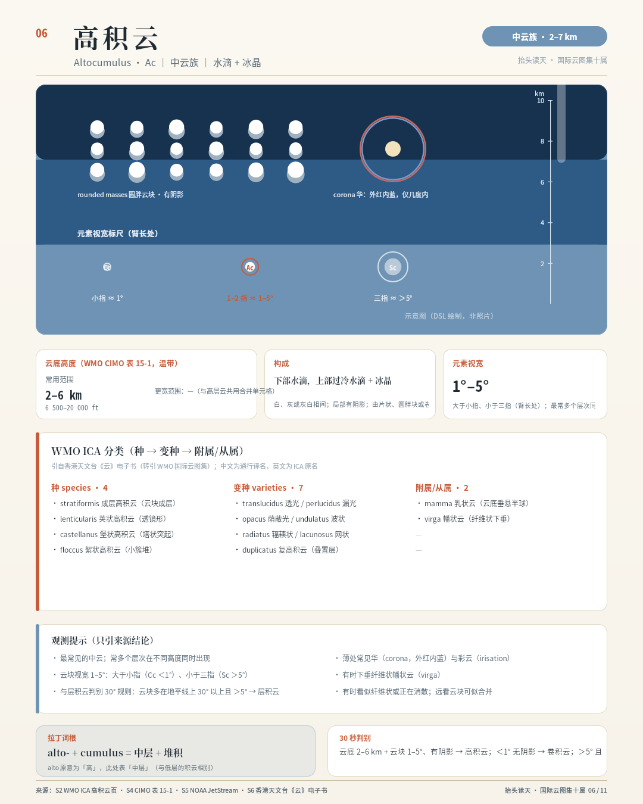

- 受众/场景：图鉴读者——见到成排云块/瓦片想确认的人 · 图鉴页 4/10：中云族首属
- 使用目标：辨认高积云的成排云块与华（corona）现象，理解 1–5° 判据
- 主导手法：成排圆块阵列 + 华环小图 + 高度轴范围带
- 主张溯源：`sources.json` claims 数组（case_id = case-06）
- 详情与完成标准证据：[case-06/case.md](case-06/case.md)

## 07. 高层云 Altostratus (As) 图鉴页（1080×1350（4:5））

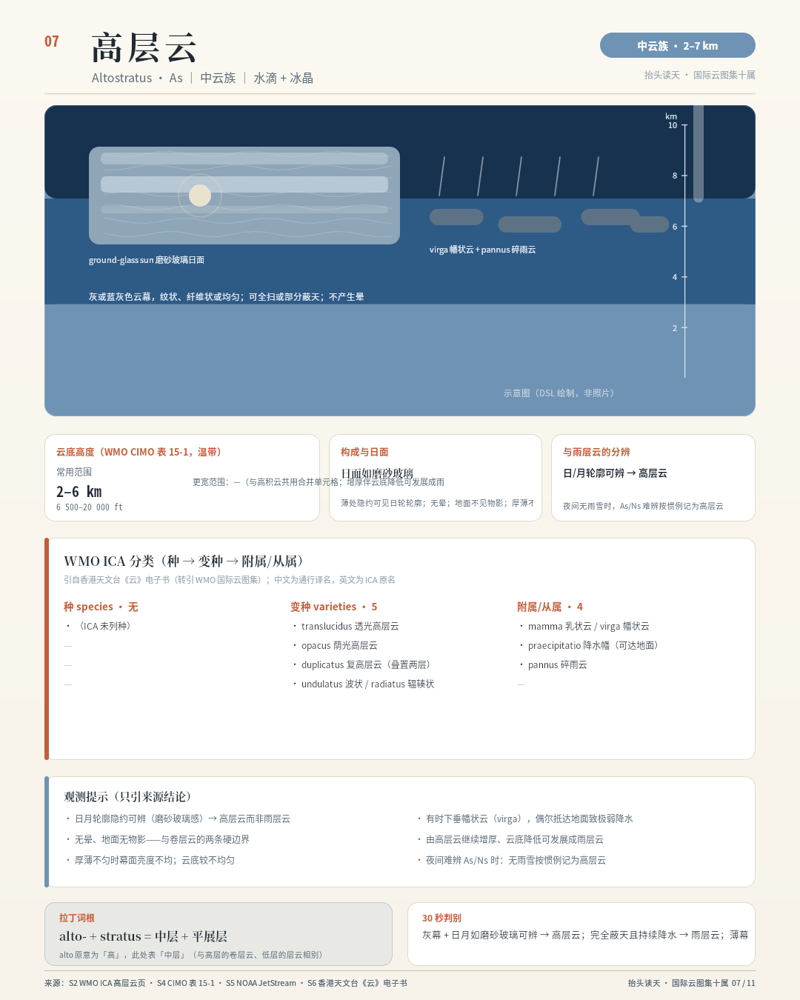

- 受众/场景：图鉴 reader——日月隔毛玻璃可见的人 · 图鉴页 5/10：中云族次属
- 使用目标：辨认高层云的磨砂日面与无晕无影特征，区分 As/Ns
- 主导手法：磨砂玻璃日面示意 + 灰幕剖面 + 高度轴范围带
- 主张溯源：`sources.json` claims 数组（case_id = case-07）
- 详情与完成标准证据：[case-07/case.md](case-07/case.md)

## 08. 雨层云 Nimbostratus (Ns) 图鉴页（1080×1350（4:5））

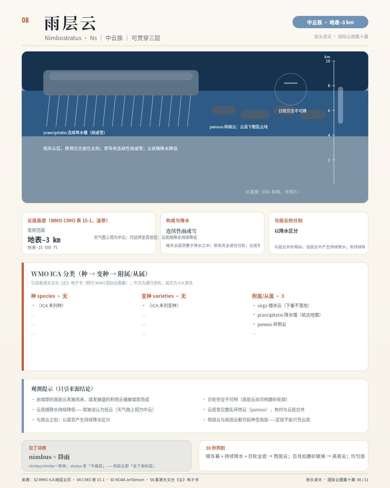

- 受众/场景：图鉴读者——阴雨连绵时想知道云名的人 · 图鉴页 6/10：中云族末属
- 使用目标：辨认雨层云的连续降水幕与碎雨云，理解其贯穿三层的例外地位
- 主导手法：暗灰雨幕 + 连续降水幡阵列 + 蔽日示意 + 高度轴范围带
- 主张溯源：`sources.json` claims 数组（case_id = case-08）
- 详情与完成标准证据：[case-08/case.md](case-08/case.md)

## 09. 层积云 Stratocumulus (Sc) 图鉴页（1080×1350（4:5））

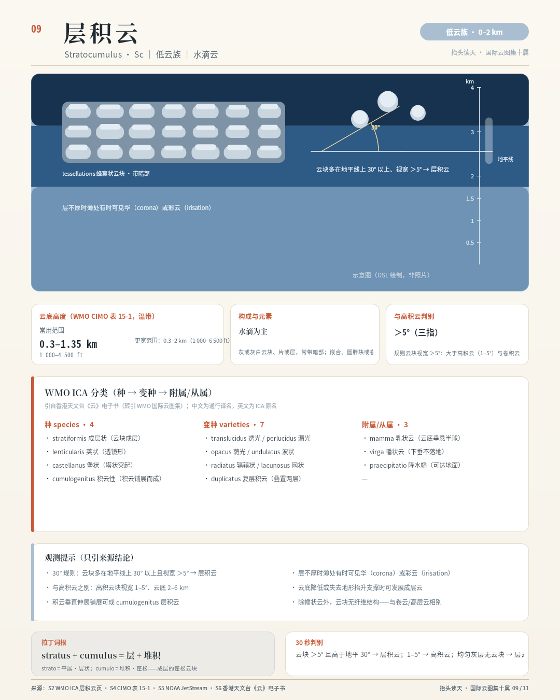

- 受众/场景：图鉴读者——见到蜂窝状云块想确认的人 · 图鉴页 7/10：低云族次属
- 使用目标：辨认层积云的蜂窝排列与 30° 判别规则
- 主导手法：蜂窝嵌合阵列（暗底亮顶）+ 30° 仰角扇区图示 + 高度轴范围带
- 主张溯源：`sources.json` claims 数组（case_id = case-09）
- 详情与完成标准证据：[case-09/case.md](case-09/case.md)

## 10. 层云 Stratus (St) 图鉴页（1080×1350（4:5））

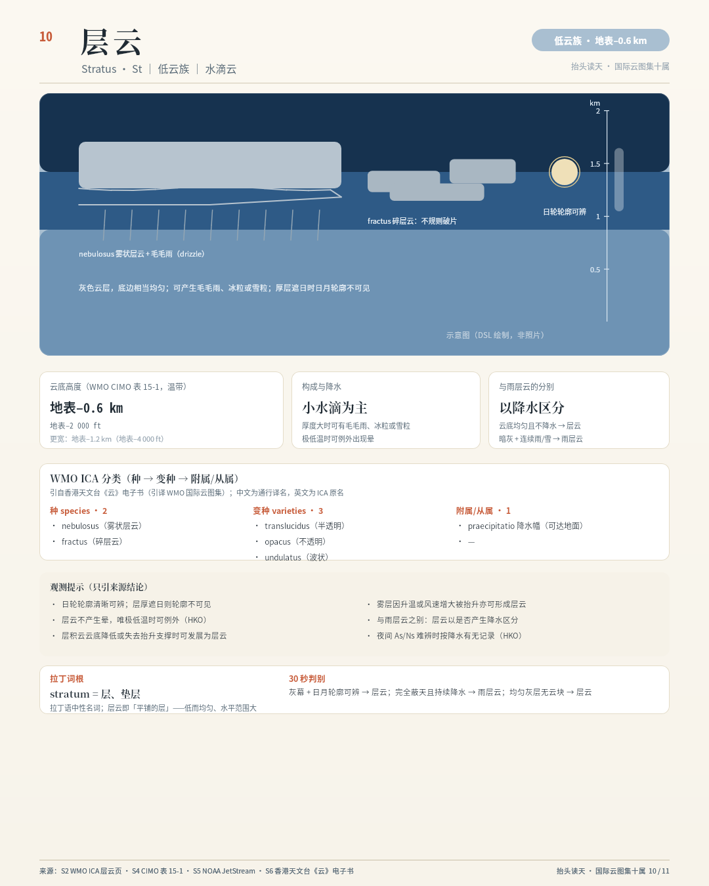

- 受众/场景：图鉴读者——阴天灰幕想确认的人 · 图鉴页 8/10：低云族末属，与 Ns 配对
- 使用目标：辨认层云的均匀灰幕与透日轮廓，与雨层云以降水区分
- 主导手法：层云幕剖面（微起伏底边）+ 碎层云破片 + 透日轮廓 + 毛毛雨
- 主张溯源：`sources.json` claims 数组（case_id = case-10）
- 详情与完成标准证据：[case-10/case.md](case-10/case.md)

## 11. 积云 → 积雨云 Cumulus/Cumulonimbus 图鉴页（对流塔）（1080×1920（9:16））

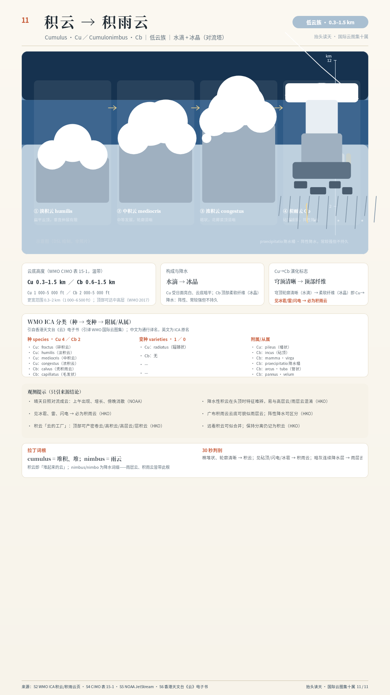

- 受众/场景：图鉴读者——夏季看云长大的所有人 · 图鉴页 9/10（压轴）：对流发展全序列
- 使用目标：沿 humilis→mediocris→congestus→Cb 四阶段读懂对流塔演化与「云的工厂」
- 主导手法：四阶段发展序列 + 砧顶/塔身/降水幡/闪电插画 + 12 km 高度轴
- 主张溯源：`sources.json` claims 数组（case_id = case-11）
- 详情与完成标准证据：[case-11/case.md](case-11/case.md)
