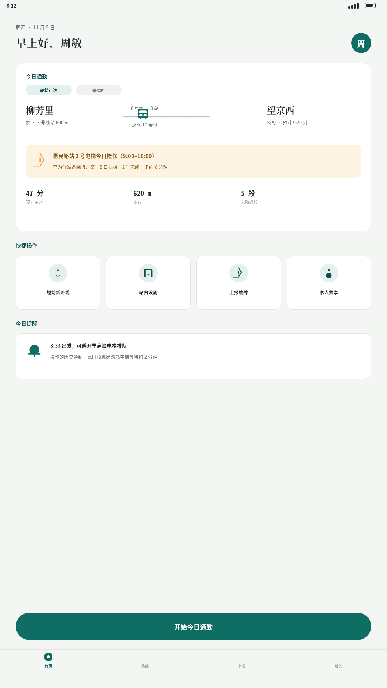
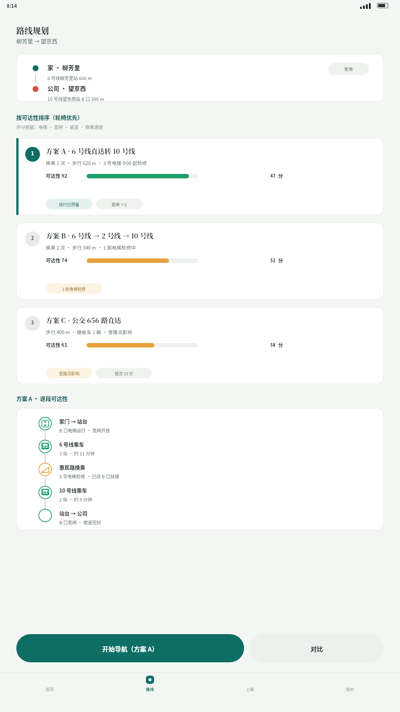
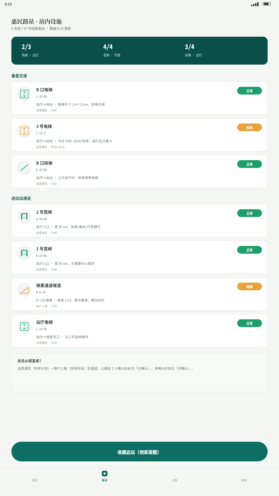
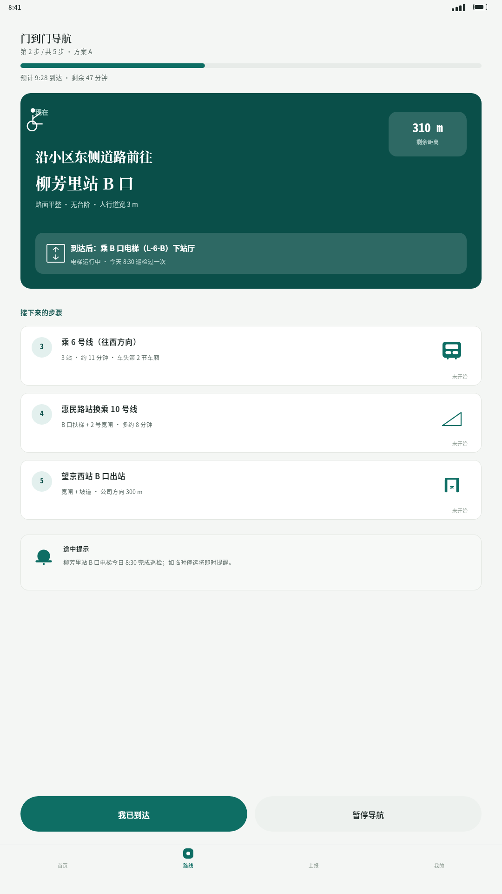
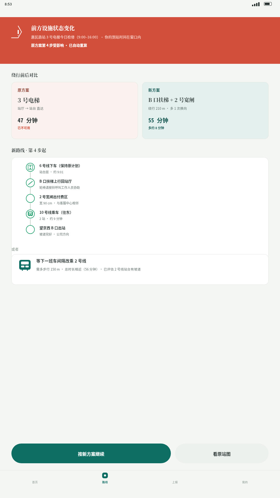
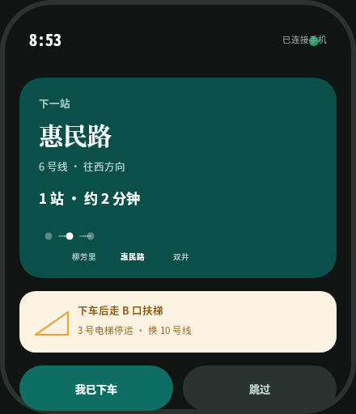
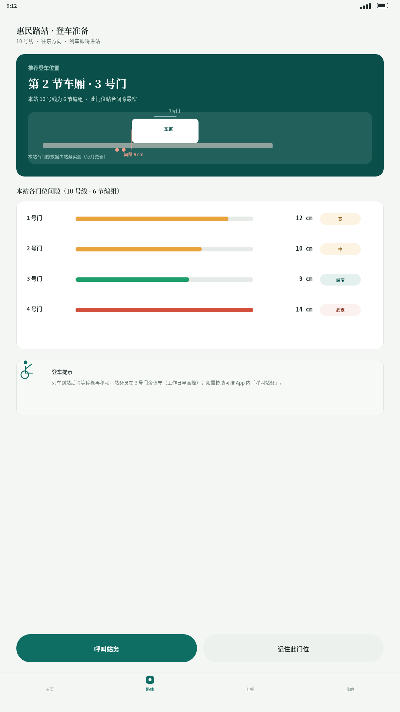
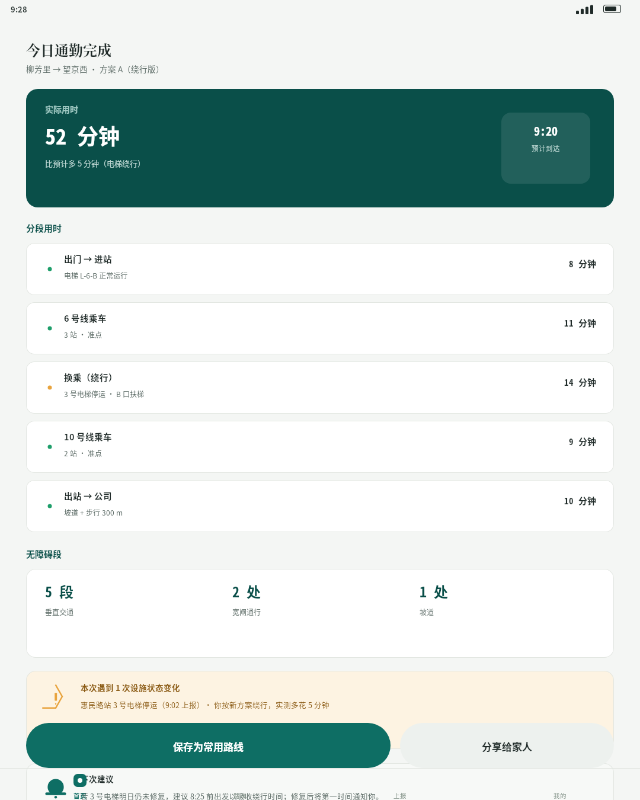
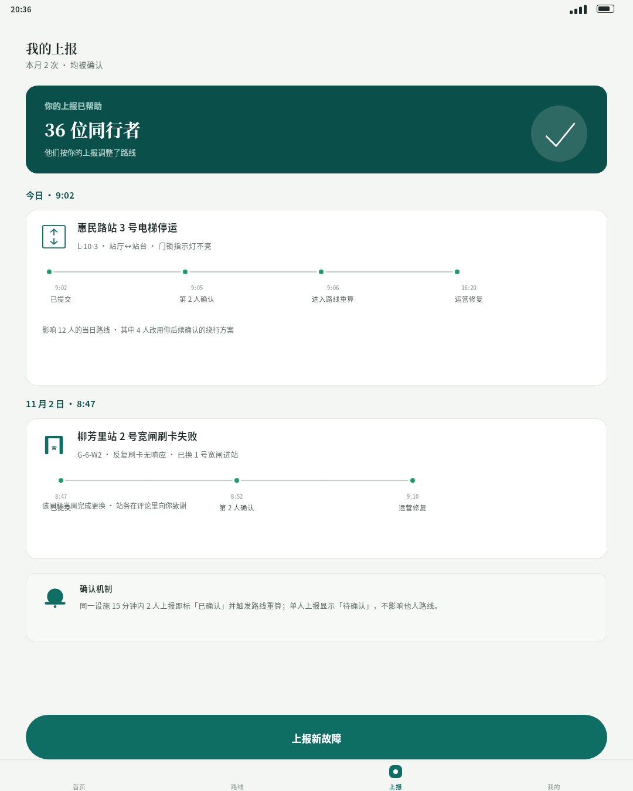
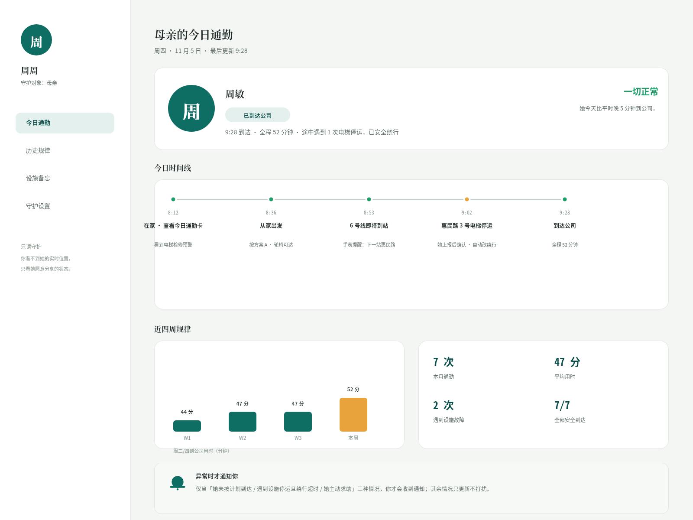

# B05 · 作品画廊

> 全部图片为 open-snapshot 服务真实渲染字节；点击查看大图。

> 横向缩略对比：`tmp/run-20261013-174209/B05/z-contact-sheet.png`

## 01. 首页「今日通勤」卡（1080×1920（9:16 手机竖屏））

- 受众/场景：轮椅通勤者周敏（出门前） · 周四早晨出门前，打开 App 看今日通勤与设施预警
- 使用目标：今日路线一眼可见 + 电梯检修预警 + 绕行预备 + 一键出发
- 主导手法：主卡（起终点+预警带+数据行）+ 四宫格快捷操作 + 提醒卡 + 底部 Tab
- 详情与完成标准证据：[case-01/case.md](case-01/case.md)

## 02. 可达性路线规划（1080×1920（9:16 手机竖屏））

- 受众/场景：轮椅通勤者周敏（规划中） · 出发前对比三条候选路线
- 使用目标：三条路线按可达性评分排序（不只最短），逐段可达性可查
- 主导手法：候选路线卡（排名徽章+评分条+标签）+ 逐段可达性时间线
- 详情与完成标准证据：[case-02/case.md](case-02/case.md)

## 03. 站内设施详情（1080×1920（9:16 手机竖屏））

- 受众/场景：轮椅通勤者周敏（出发前核查） · 查看惠民路站逐设施实时状态
- 使用目标：电梯/宽闸/扶梯/坡道逐项状态 + 来源说明
- 主导手法：深青总览条（2/3·4/4·3/4）+ 设施行卡（图标+状态章+更新时间）+ 说明卡
- 详情与完成标准证据：[case-03/case.md](case-03/case.md)

## 04. 分步门到门导航（1080×1920（9:16 手机竖屏））

- 受众/场景：轮椅通勤者周敏（出行中，第 2/5 步） · 沿小区道路前往柳芳里站 B 口
- 使用目标：大步骤卡 + 剩余距离 + 到达后动作 + 后续步骤预览
- 主导手法：深青大步骤卡（距离徽章+动作提示槽）+ 步骤列表 + 途中提示
- 详情与完成标准证据：[case-04/case.md](case-04/case.md)

## 05. 换乘绕行：电梯检修（1080×1920（9:16 手机竖屏））

- 受众/场景：轮椅通勤者周敏（换乘站状态变化） · 8:53 车上：惠民路站 3 号电梯今日检修，App 自动改走 B 口扶梯绕行
- 使用目标：设施状态变化即时重算 + 绕行代价透明 + 备选方案 + 一键继续
- 主导手法：红色告警头 + 绕行前后对比双卡 + 新路线逐段 + 备选卡
- 详情与完成标准证据：[case-05/case.md](case-05/case.md)

## 06. 手表到站提醒（440×512（55:64 方形小屏））

- 受众/场景：轮椅通勤者周敏（6 号线即将到惠民路） · 抬腕看表：下一站 + 倒计时 + 下车后动作
- 使用目标：小屏只给一件事——准备下车；不需掏手机
- 主导手法：深底表盘 + 深青主卡（下一站/倒计时/行程点）+ 浅黄动作卡 + 双按钮
- 详情与完成标准证据：[case-06/case.md](case-06/case.md)

## 07. 站台间隙与车厢门位（1080×1920（9:16 手机竖屏））

- 受众/场景：轮椅通勤者周敏（惠民路站登车前，绕行后换乘 10 号线） · 列车即将进站，确认登车门位
- 使用目标：间隙数据透明 + 推荐门位 + 呼叫站务
- 主导手法：深青推荐卡（门位+间隙剖面）+ 四门位间隙对比条 + 登车提示
- 详情与完成标准证据：[case-07/case.md](case-07/case.md)

## 08. 到达回顾（1080×1350（4:5 手机竖屏））

- 受众/场景：轮椅通勤者周敏（到达公司后） · 查看今日全程用时与事件回看
- 使用目标：实际用时/分段用时/无障碍段/事件/下次建议
- 主导手法：深青总览卡 + 分段行（状态点+时长）+ 统计三联 + 事件卡 + 建议卡
- 详情与完成标准证据：[case-08/case.md](case-08/case.md)

## 09. 故障上报与反馈（1080×1350（4:5 手机竖屏））

- 受众/场景：轮椅通勤者周敏（晚间回看上报记录） · 查看本月两条上报的状态链与社区影响
- 使用目标：上报被确认/影响人数/社区致谢/确认机制透明
- 主导手法：深青贡献卡 + 两条上报记录（状态链时间线）+ 机制说明卡
- 详情与完成标准证据：[case-09/case.md](case-09/case.md)

## 10. 家庭共享视图（1600×1200（4:3 平板横屏））

- 受众/场景：女儿周周（远程守护者） · 在平板上查看母亲今日通勤状态
- 使用目标：只读守护：今日状态/时间线/历史规律/异常才通知
- 主导手法：侧栏菜单 + 状态大卡 + 五节点时间线 + 柱状图 + 概览四联 + 设置提示
- 详情与完成标准证据：[case-10/case.md](case-10/case.md)
