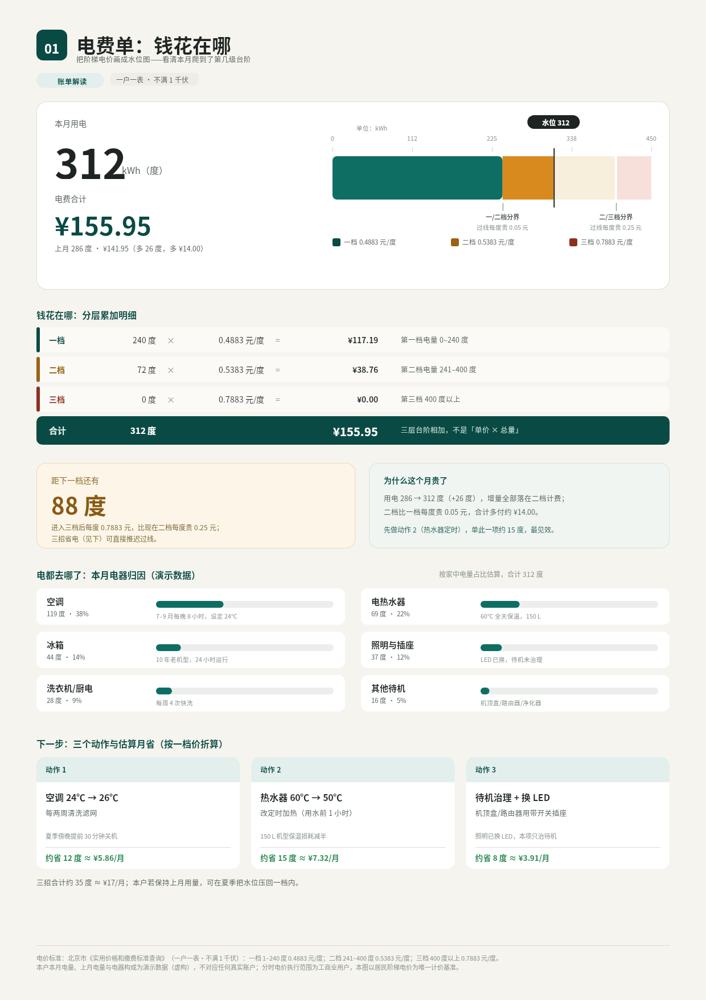
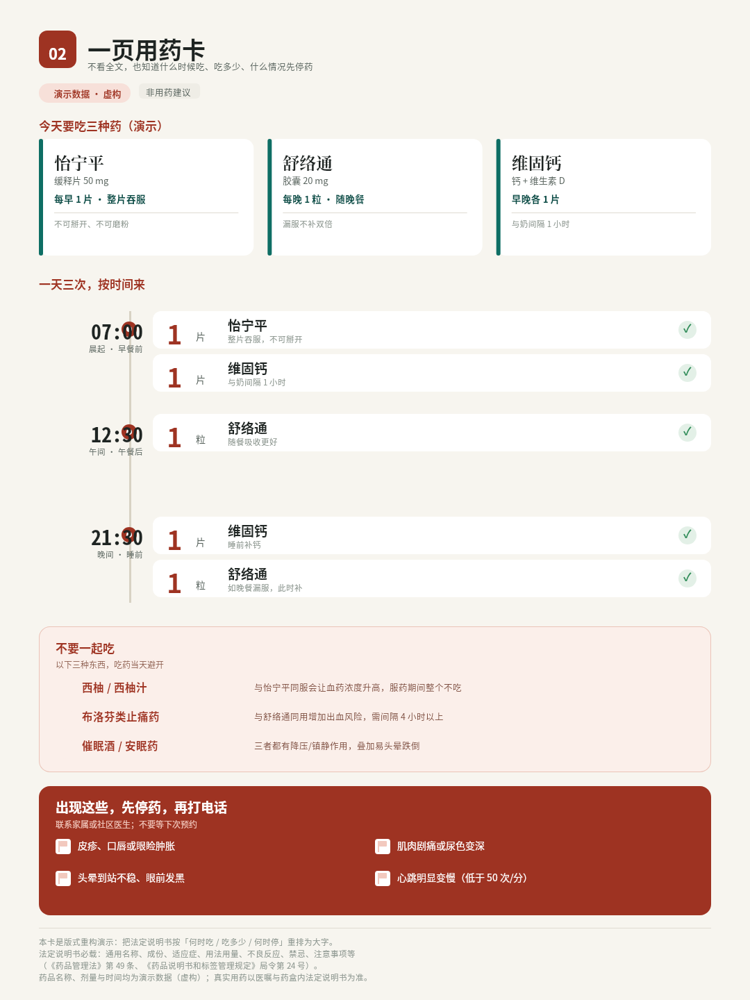
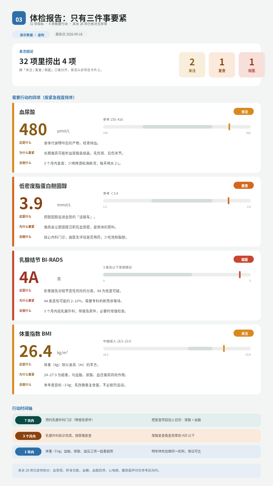
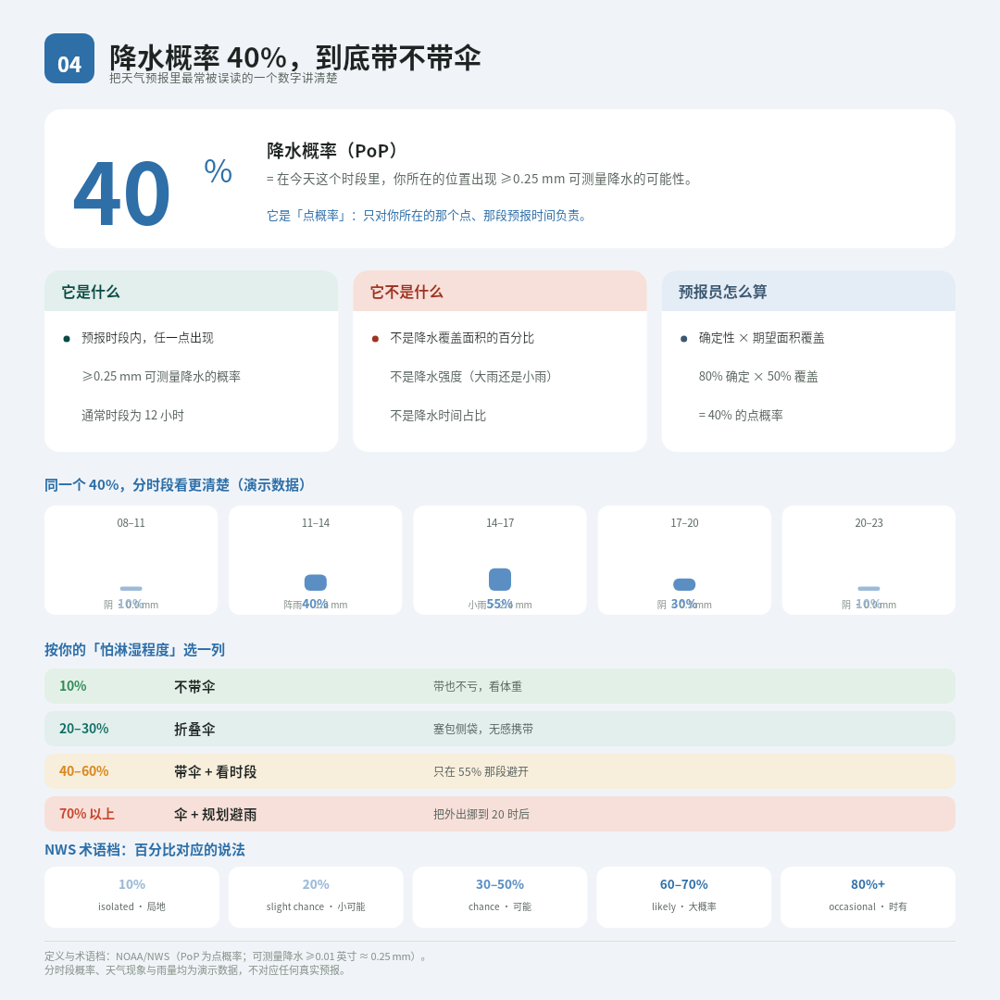
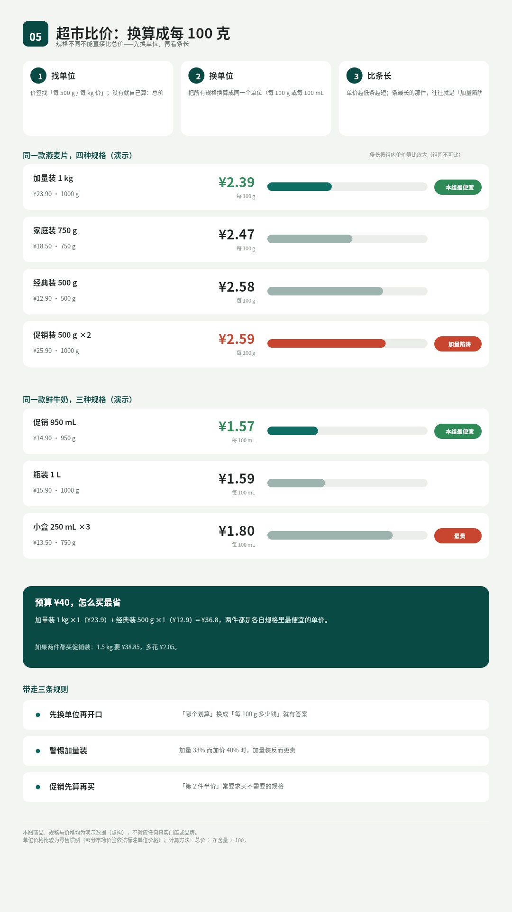
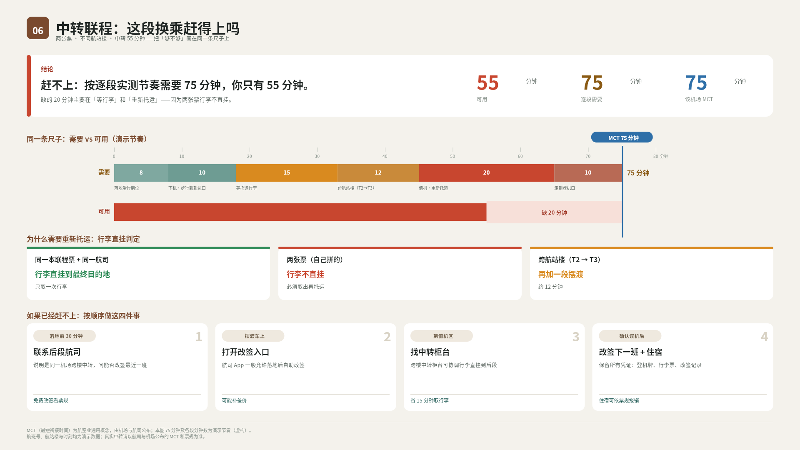
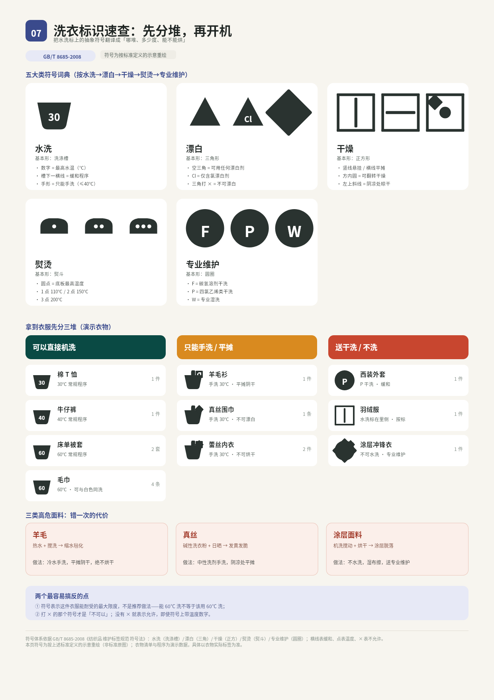
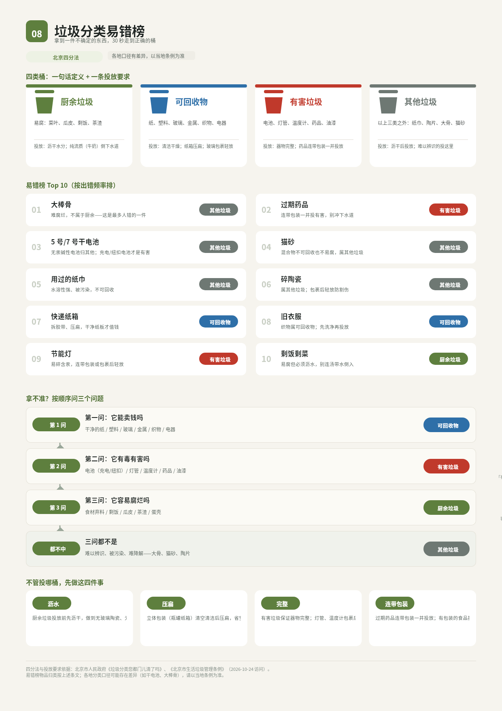
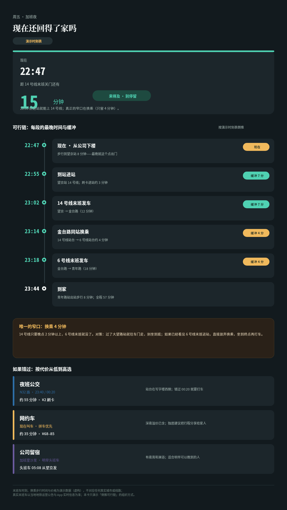
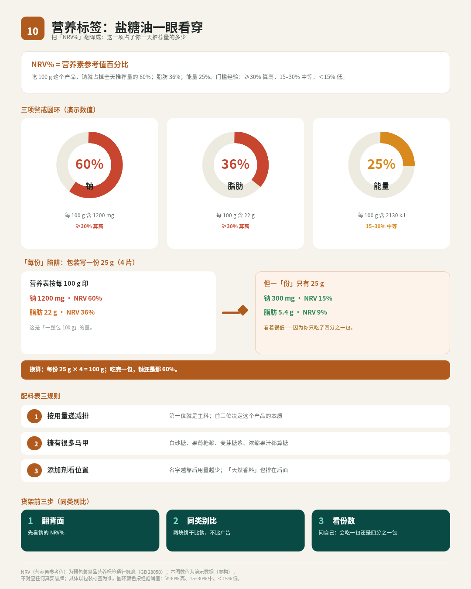

# B06 · 作品画廊

> 全部图片为 open-snapshot 服务真实渲染字节；点击查看大图。

> 横向缩略对比：`tmp/run-20261013-174209/B06/z-contact-sheet.png`

## 01. 电费单：钱花在哪（阶梯水位图）（A4 竖版 1240×1754）

- 受众/场景：家庭里管账单的人（30–50 岁）与第一次自己缴电费的租房年轻人 · A4 竖版 1240×1754，打印贴冰箱或夹进账单夹；也可在手机上看同版竖图
- 使用目标：看懂本月电费构成，知道再做多少度会进更贵的档，以及哪三个动作最可能省钱
- 主导手法：水位图/闸口/分层累加行/归因横条/动作卡
- 内容依据：R1 北京阶梯电价公开标准（一户一表·不满 1 千伏）；本户电量与构成为演示数据
- 详情与完成标准证据：[case-01/case.md](case-01/case.md)

## 02. 一页用药卡：什么时候吃、吃多少、什么情况停（3:4 竖版 1080×1440）

- 受众/场景：65 岁以上慢病患者与其成年子女（照护者） · 3:4 竖版 1080×1440 大字卡，压餐桌玻璃板下或贴药盒盖内侧
- 使用目标：不读全文也能答：早中晚各吃什么、吃几片、不能和什么同服、出现什么情况停药并打电话
- 主导手法：垂直时间轴/大字剂量块/旋转斜杠禁令牌/红旗清单
- 内容依据：R5 法定说明书结构（药品管理法第 49 条/局令第 24 号）；药品与剂量为演示数据
- 详情与完成标准证据：[case-02/case.md](case-02/case.md)

## 03. 体检报告：三十个箭头里只有三件事要紧（9:16 竖版 1080×1920）

- 受众/场景：35–55 岁第一次认真看自己体检报告的上班族 · 手机竖屏 9:16（1080×1920），报告短信链接里点开的同一张解读卡
- 使用目标：1 分钟内知道：本次有几个真异常、分别意味着什么、接下来 7 天/3 个月/1 年各做什么
- 主导手法：分级色带/参考区间条（标记越界可见）/三段行动轴
- 内容依据：R7 常用参考区间（注明以报告单所印为准）+ R3 血压分级；患者数据为演示数据
- 详情与完成标准证据：[case-03/case.md](case-03/case.md)

## 04. 降水概率 40%：到底带不带伞（1:1 方形 1080×1080）

- 受众/场景：每天看天气决定带不带伞、要不要收衣服的通勤者与家长 · 1:1 方形卡 1080×1080，聊天里转发或打印成冰箱贴
- 使用目标：正确理解 PoP 含义，并按自己「怕淋湿程度」给出明确带伞建议
- 主导手法：大数字/三格对照/概率竖条/阈值表/术语档
- 内容依据：R2 NOAA/NWS PoP 定义与术语档；分时段数据为演示
- 详情与完成标准证据：[case-04/case.md](case-04/case.md)

## 05. 超市比价：把价签换算成每 100 克（9:16 竖版 1080×1920）

- 受众/场景：每周采购的家庭成员；价格敏感的学生与合租青年 · 手机竖屏 9:16（1080×1920），超市里边走边看
- 使用目标：三秒内看出哪种规格单位价格最低、促销是否真便宜、预算内买哪件
- 主导手法：单位换算横条（组内放大）/升序排列/徽标/预算卡
- 内容依据：自拟演示商品与价格（R8），不引用任何真实门店
- 详情与完成标准证据：[case-05/case.md](case-05/case.md)

## 06. 中转联程：这段换乘到底赶得上吗（16:9 横版 1920×1080）

- 受众/场景：第一次独自中转的旅客（含带老人孩子出行的家庭） · 16:9 横版 1920×1080，出行前在电脑上看，也可打印折进行李袋
- 使用目标：判断中转时间是否安全、行李是否直挂、哪段最赶、误了之后的补救顺序
- 主导手法：等比分段时间轴/缺口区/警戒线/判定卡/补救阶梯
- 内容依据：MCT 为航空业通用概念，数值为演示（R8）；航班与时刻为演示数据
- 详情与完成标准证据：[case-06/case.md](case-06/case.md)

## 07. 洗衣标识速查：先分堆，再开机（A4 竖版 1240×1754）

- 受众/场景：第一次独立洗衣的大学生、合租青年、新手家务者 · A4 竖版 1240×1754 贴洗衣机上方墙面，站立 1 m 可读
- 使用目标：把手里的衣服按符号分堆：能机洗/只能手洗/送干洗；知道水温与能否烘干
- 主导手法：ClipPath 异形裁剪/旋转细条/圆点温度档/方框四边/分拣行
- 内容依据：R4 GB/T 8685-2008 符号体系；衣物清单为演示数据；符号为示意重绘
- 详情与完成标准证据：[case-07/case.md](case-07/case.md)

## 08. 垃圾分类易错榜：大棒骨、过期药去哪桶（A4 竖版 1240×1754）

- 受众/场景：家庭厨房主理人与租户；刚来城市生活的人 · A4 竖版 1240×1754 贴垃圾桶上方或厨房门后，站立 1 m 可读
- 使用目标：拿到一件不确定的东西，30 秒内按图走到正确桶；记住投放前处理要求
- 主导手法：桶形图标（ClipPath 梯形）/易错排名/三问树/向下箭头
- 内容依据：R6 北京四分法与投放要求（北京市政府/市条例）
- 详情与完成标准证据：[case-08/case.md](case-08/case.md)

## 09. 末班车：现在还回得了家吗（9:16 竖版 1080×1920）

- 受众/场景：加班晚归的上班族，尤其不愿天天打车的人 · 手机竖屏 9:16（1080×1920），晚 10 点后办公室/地铁站单手看
- 使用目标：知道现在出发走哪条路能上车、哪一班是最后一班赶得上的、赶不上的备选与代价
- 主导手法：倒计时大字/时间轨/缓冲徽标/窄口告警/备选阶梯
- 内容依据：末班时刻表为演示数据（R8）；结构参照城市地铁常见首末班信息
- 详情与完成标准证据：[case-09/case.md](case-09/case.md)

## 10. 营养标签：盐糖油一眼看穿（4:5 竖版 1080×1350）

- 受众/场景：开始关注饮食健康的采购者（控糖/控盐/减脂人群及其家人） · 4:5 竖版 1080×1350，超市/厨房拿起就看；可贴餐桌旁
- 使用目标：在两件同类商品中快速判断哪个盐/糖/脂肪更低，并知道 NRV% 的正确读法
- 主导手法：圆环进度（ring_segment）/警戒色/左右对照卡/换算注
- 内容依据：NRV 概念为 GB 28050 通行内容；数值为演示数据（R8）
- 详情与完成标准证据：[case-10/case.md](case-10/case.md)
